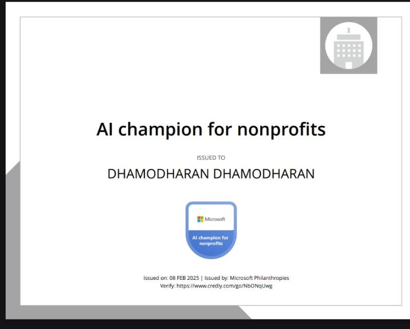

# Certifications & Professional Development

> **Accredited credentials in AI enablement, game development, 21st-century pedagogy, and industrial quality inspection.**

---

## 🏆 Featured Certifications & Credentials

### 1. AI Champion for Nonprofits
* **Issuing Organization:** **Microsoft Philanthropies**
* **Issue Date:** February 8, 2025
* **Credential Scope:** Equipping non-profit organizations and social enterprises with AI workflows, digital empowerment tools, and ethical artificial intelligence practices.
* **Verification Link:** [Verify on Credly (credly.com/go/NbONqUwg)](https://www.credly.com/go/NbONqUwg)
* **Certificate Artifact:**  
  

---

### 2. Canva Design School Certification Award: AI for Nonprofits
* **Issuing Organization:** **Canva Design School**
* **Award Verification:** [Canva Certification Award (Award ID: 22e9b153-1731-43d4-bf11-501976af7d89)](https://www.canva.com/design-school/certification-award/22e9b153-1731-43d4-bf11-501976af7d89)
* **Learning Path Completed:** **AI for Nonprofits** *(Completed October 20, 2026)*
* **Curriculum & Completed Course Series:**
  1. **Welcome to the AI for Nonprofits Course Series** *(Completed: Aug 30, 2026)*
  2. **Daily Wins with AI for Nonprofits** *(Completed: Oct 20, 2026)*
  3. **Build Smarter Workflows with AI for Nonprofits** *(Completed: Oct 13, 2026)*
  4. **Data Analysis with AI for Nonprofits** *(Completed: Oct 19, 2026)*
  5. **Optimize Creativity and Fundraising with AI for Nonprofits** *(Completed: Oct 20, 2026)*
* **Certificate & Learning Path Verification:**  
  

---

### 3. Certified CodeAI Facilitator (AI Concentrator Track)
* **Issuing Organization:** **CodeAI** ([code.org](https://code.org))
* **Issue Date:** October 2026 | **Certificate ID:** `IFT26-029`
* **Signatory:** **Karim Meghji** — *President and CEO, CodeAI*
* **Verification Contact:** `felipe.fontecilla@code.org`
* **Training Volume:** 16 Hours of Professional Learning:
  * *Facilitator 101 Workshop* (10h)
  * *CodeAI Pedagogy – International Course* (2h)
  * *Dance Party: AI Edition* (1h)
  * *AI for Oceans* (1h)
  * *Mix & Move with AI* (2h)
* **Certificate Document:** [View PDF Document](assets/certificates/IFT26-029_Dhamodharan_K.pdf)

---

### 4. Unity Professional Development Course
* **Issuing Organization:** **Unity Technologies (Unity Education)**
* **Issue Date:** August 10, 2025
* **Course Instructor:** **Bradston Henry** — *Professional Development Course Instructor*
* **Course Scope & Accomplishments:**
  * Completed 3 weeks (~7 hours 15 minutes) of foundational Unity game development instruction.
  * Planned an instructional curriculum for teaching Unity game development.
  * Mastered pedagogical best practices for delivering Unity game engines in educational settings.
  * Developed and compiled a **3D Interactive Gallery Project**.
* **Certificate Artifact:**  
  

---

### 5. Teacher Educator Programme: Skills for 21st Century Teaching & Learning
* **Issuing Organizations:** **The Open University (OU)**, **African Council for Distance Education (ACDE)**, **TESSA**, **Institute of Educational Technology (IET)**
* **Issue Date:** April 7, 2025
* **Course Focus:** How teacher educators can model excellent teaching practices and mentor teachers to develop modern 21st-century pedagogical skills.
* **Verification & Course Link:** [OpenLearn Create (Course ID: 5757)](https://www.open.edu/openlearncreate/course/view.php?id=5757)
* **License:** Creative Commons Attribution-NonCommercial (CC BY-NC)
* **Certificate Artifact:**  
  

---

### 6. Code Clubs Knowledge Level Certificate
* **Issuing Organization:** **Team4Tech**
* **Date Recorded:** August 16, 2026
* **Signatory:** **Julie Clugage** — *Co-Founder and Executive Director, Team4Tech*
* **Competency:** Successful completion of the Code Clubs course and knowledge assessment, fostering community-based coding programs for youth.
* **Certificate Artifact:**  
  

---

### 7. Certificate of Appreciation — Mentor in Vivo Ignite 2026
* **Issuing Organizations:** **Shooting Stars Foundation** & **Mango Education**
* **Role:** **Mentor**
* **Signatory:** **R. Obuli Chandran** — *CEO, Mango Education*
* **Citation:** In recognition of outstanding mentorship guiding student participants to refine scientific concepts, fabricate functional prototypes, and produce competition videos.
* **Certificate Document:** [View PDF Document](assets/certificates/Dhamodharan%20-%20Vivo%20Ignite%202026%20-%20Mentoring%20Certificate.pdf)

---

### 8. NDT Level II Certified Inspector
* **Certification Standard:** **SNT-TC-1A**
* **Issuing Body:** **Quality Inspection Services (QIS), Trichy**
* **Competency:** Non-Destructive Testing practical and theoretical inspection methods for structural materials, welds, and manufactured mechanical components.
