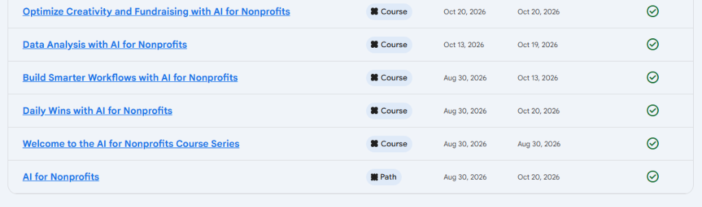
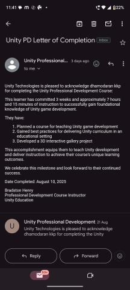
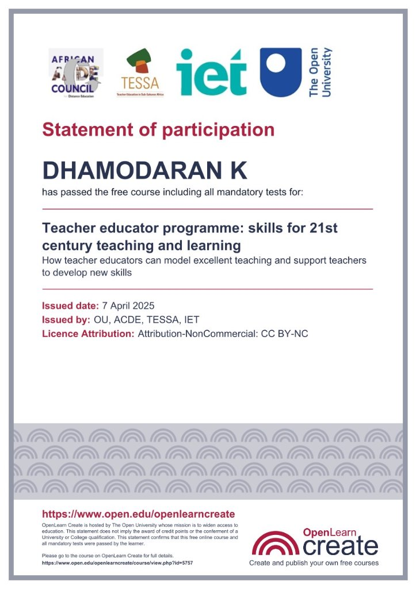
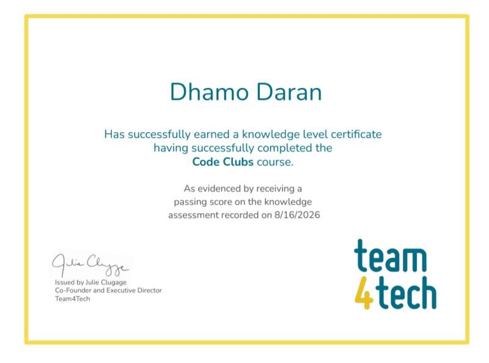

# Certifications & Credentials

Credentials in AI workflows for nonprofits, Unity development, educator training, and industrial NDT inspection.

---

## Featured Certifications & Credentials

### 1. AI Champion for Nonprofits

* **Issuing Organization:** Microsoft Philanthropies
* **Issue Date:** February 8, 2025
* **Scope:** Practical AI workflows and digital tools for nonprofit operations.
* **Verification:** [Credly Badge (credly.com/go/NbONqUwg)](https://www.credly.com/go/NbONqUwg)

---

### 2. Canva Design School Certification Award: AI for Nonprofits

* **Issuing Organization:** Canva Design School
* **Verification:** [Canva Award (ID: 22e9b153-1731-43d4-bf11-501976af7d89)](https://www.canva.com/design-school/certification-award/22e9b153-1731-43d4-bf11-501976af7d89)
* **Learning Path:** AI for Nonprofits *(Completed October 20, 2026)*
* **Completed Courses:**
  1. Welcome to the AI for Nonprofits Course Series *(Aug 30, 2026)*
  2. Daily Wins with AI for Nonprofits *(Oct 20, 2026)*
  3. Build Smarter Workflows with AI for Nonprofits *(Oct 13, 2026)*
  4. Data Analysis with AI for Nonprofits *(Oct 19, 2026)*
  5. Optimize Creativity and Fundraising with AI for Nonprofits *(Oct 20, 2026)*

---

### 3. Certified CodeAI Facilitator (AI Concentrator Track)

* **Issuing Organization:** CodeAI ([code.org](https://code.org))
* **Issue Date:** October 2026 | **Certificate ID:** `IFT26-029`
* **Signatory:** Karim Meghji — *President and CEO, CodeAI*
* **Verification Contact:** `felipe.fontecilla@code.org`
* **Training Hours:** 16 hours total
  * *Facilitator 101 Workshop* (10h)
  * *CodeAI Pedagogy – International Course* (2h)
  * *Dance Party: AI Edition* (1h)
  * *AI for Oceans* (1h)
  * *Mix & Move with AI* (2h)
* **Document:** [View PDF Document](assets/certificates/IFT26-029_Dhamodharan_K.pdf)

---

### 4. Unity Professional Development Course

* **Issuing Organization:** Unity Technologies (Unity Education)
* **Issue Date:** August 10, 2025
* **Instructor:** Bradston Henry — *Professional Development Course Instructor*
* **Summary:**
  * Completed 3 weeks (~7 hours 15 minutes) of foundational Unity instruction.
  * Planned a curriculum for teaching Unity game development and built a **3D Interactive Gallery Project**.

---

### 5. Teacher Educator Programme: Skills for 21st Century Teaching & Learning

* **Issuing Organizations:** The Open University (OU), African Council for Distance Education (ACDE), TESSA, Institute of Educational Technology (IET)
* **Issue Date:** April 7, 2025
* **Focus:** Modeling effective teaching practices and supporting teachers in developing new skills.
* **Course Link:** [OpenLearn Create (Course ID: 5757)](https://www.open.edu/openlearncreate/course/view.php?id=5757)
* **License:** Creative Commons Attribution-NonCommercial (CC BY-NC)

---

### 6. Code Clubs Knowledge Level Certificate

* **Issuing Organization:** Team4Tech
* **Date Recorded:** August 16, 2026
* **Signatory:** Julie Clugage — *Co-Founder and Executive Director, Team4Tech*
* **Summary:** Completed the Code Clubs course and knowledge assessment on running youth coding programs.

---

### 7. Certificate of Appreciation — Mentor in Vivo Ignite 2026

* **Issuing Organizations:** Shooting Stars Foundation & Mango Education
* **Role:** Mentor
* **Signatory:** R. Obuli Chandran — *CEO, Mango Education*
* **Summary:** Recognized for mentoring student participants on prototype development and competition presentation videos.
* **Document:** [View PDF Document](assets/certificates/Dhamodharan%20-%20Vivo%20Ignite%202026%20-%20Mentoring%20Certificate.pdf)

---

### 8. NDT Level II Certified Inspector

* **Standard:** SNT-TC-1A
* **Issuing Body:** Quality Inspection Services (QIS), Trichy
* **Scope:** Practical and theoretical Non-Destructive Testing (NDT) inspection for structural materials, welds, and mechanical components.
