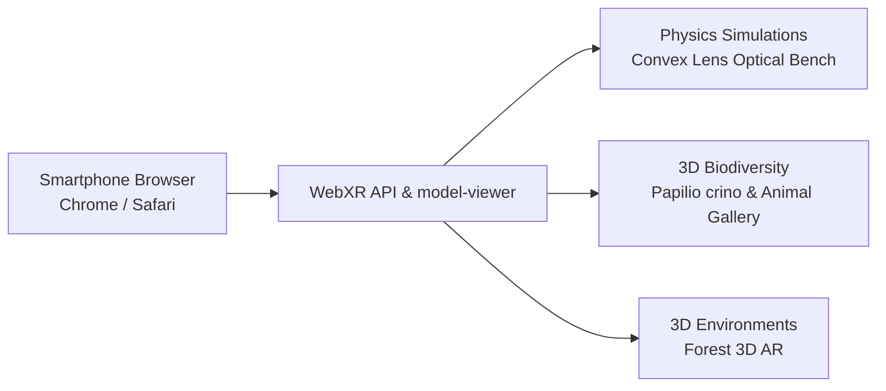

# Augmented Reality (AR) & WebXR Projects

*Developed by Dhamodharan KKP — Design Contributor at Tecplore*

---

## Overview

These projects use **WebXR**, **Three.js**, and **Google `<model-viewer>`** to run interactive 3D and AR experiences directly inside a mobile web browser—no app installation required. The focus is on physics simulations and 3D biodiversity models that students can place on a tabletop using a standard smartphone.

---

## Projects

### 1. Convex Lens Optical Bench WebXR Simulation (Tamil Nadu 10th Physics)
* **Repository:** [`convex-lens-webxr-tamil`](https://github.com/dhamodharankkp-oss/convex-lens-webxr-tamil)
* **Focus:** WebXR and live camera AR simulation built for Tamil Nadu State Board Class 10 Physics (*Light — Refraction & Lenses*).
* **Details:**
  * Places an interactive optical bench on a tabletop in AR.
  * Real-time ray tracing with adjustable object positions ($f$, $2f$, between $F$ and $2F$, infinity).
  * Shows real, inverted, virtual, and erect image formation with bilingual Tamil/English labels.

### 2. Web AR 3D Animal Gallery
* **Repository:** [`web-ar-animal-gallery`](https://github.com/dhamodharankkp-oss/web-ar-animal-gallery)
* **Focus:** True-to-scale 3D animal models viewable in AR using `<model-viewer>`.
* **Details:** Works out of the box on Android (Scene Viewer) and iOS (Quick Look) with PBR textures.

### 3. Butterfly AR: Common Banded Peacock (*Papilio crino*)
* **Repositories:** [`butterfly-ar`](https://github.com/dhamodharankkp-oss/butterfly-ar) & [`papilio-crino-ar`](https://github.com/dhamodharankkp-oss/papilio-crino-ar)
* **Focus:** Life-sized 3D flight animation of *Papilio crino* (Common Banded Peacock).
* **Details:** Wing-flapping animation and structural color rendering, linking digital 3D models with local biodiversity observations on **iNaturalist**.

### 4. Forest 3D AR Environment
* **Repository:** [`forest-3d-ar`](https://github.com/dhamodharankkp-oss/forest-3d-ar)
* **Focus:** Interactive 3D forest environment with spatial audio and foliage rendering.

---

## Technical Stack

* **Web Standards:** WebXR Device API, WebGL 2.0, glTF / GLB
* **Libraries:** Three.js, `@google/model-viewer`
* **Hosting:** GitHub Pages
