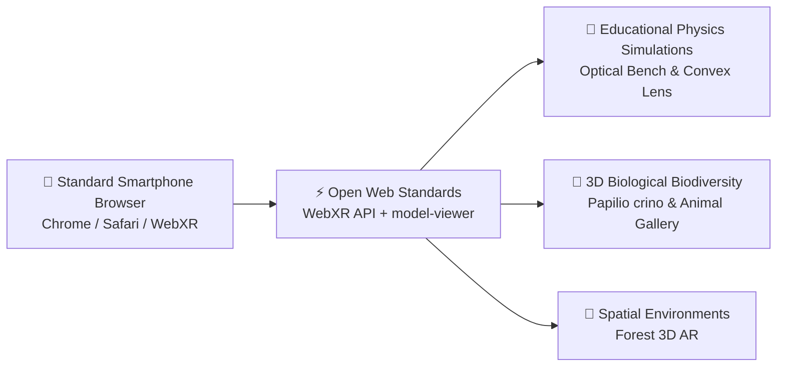

# Augmented Reality (AR) & WebXR Projects: Overview

> **Browser-Based Spatial Computing, Educational Physics Simulations, and 3D Biodiversity Experiences**  
> *Developed by Dhamodharan KKP — Design Contributor at Tecplore*

---

## 🌐 Overview & Philosophy

Modern mobile browsers support immersive spatial computing through open web standards without requiring heavy app store downloads. Leveraging **WebXR**, **Three.js**, and **Google `<model-viewer>`**, this portfolio of Augmented Reality (AR) experiences brings abstract scientific experiments and biological models directly into the learner's physical room.

---

## 🚀 Key AR & WebXR Initiatives

### 1. Convex Lens Optical Bench WebXR Simulation (Tamil Nadu 10th Physics)
* **Repository:** [`convex-lens-webxr-tamil`](https://github.com/dhamodharankkp-oss/convex-lens-webxr-tamil)
* **Focus:** Photorealistic WebXR and live camera AR simulation tailored for Tamil Nadu State Board Class 10 Physics (Light - Refraction & Lenses).
* **Key Features:**
  * Interactive optical bench placed onto the student's tabletop in augmented reality.
  * Real-time ray tracing and dynamic focal length adjustments ($f$, $2f$, between $F$ and $2F$, infinity).
  * Instant visualization of real, inverted, virtual, and erect image formation with bilingual Tamil/English guidance.

### 2. Web AR 3D Animal Gallery
* **Repository:** [`web-ar-animal-gallery`](https://github.com/dhamodharankkp-oss/web-ar-animal-gallery)
* **Focus:** Interactive 3D biological specimens viewable in true-to-scale augmented reality via Google `<model-viewer>`.
* **Key Features:**
  * Zero-install instant AR on Android (Scene Viewer) and iOS (Quick Look ARKit).
  * High-fidelity PBR textures, anatomical inspection, and classroom biology integration.

### 3. Butterfly AR: Common Banded Peacock (*Papilio crino*)
* **Repository:** [`butterfly-ar`](https://github.com/dhamodharankkp-oss/butterfly-ar) & [`papilio-crino-ar`](https://github.com/dhamodharankkp-oss/papilio-crino-ar)
* **Focus:** Life-sized 3D flight animation and anatomical study of Southern India's iconic *Papilio crino* butterfly.
* **Key Features:**
  * Realistic wing flapping kinematics and iridescent structural color rendering.
  * Connects digital 3D models with outdoor biodiversity tracking on **iNaturalist**.

### 4. Forest 3D AR Environment
* **Repository:** [`forest-3d-ar`](https://github.com/dhamodharankkp-oss/forest-3d-ar)
* **Focus:** Spatial ecology and immersive forest canopy environment.
* **Key Features:**
  * Spatial audio and foliage rendering exploring environmental awareness and interactive nature discovery.

---

## 🛠️ Technical Stack
* **Standards:** WebXR Device API, WebGL 2.0, glTF / GLB asset formats.
* **Libraries:** Three.js, `@google/model-viewer`.
* **Deployment:** GitHub Pages (Public & Mobile-Ready).
