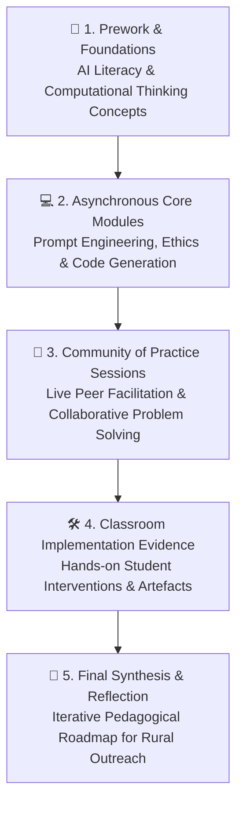

# AI + Computer Science Instructional Facilitator Training (CodeAI)

> **Empowering Educators to Integrate Artificial Intelligence & Computer Science in Community Practice**  
> *Facilitated and Documented by Dhamodharan KKP*

---

## 📘 Program Overview

The **AI + Computer Science Instructional Facilitator Training (CodeAI IFT)** is an intensive professional development and community-of-practice program designed to prepare instructional leaders and makerspace educators to bring AI literacy, computational thinking, and hands-on computer science into grassroots learning environments.

As an active instructional facilitator and makerspace educator at **Aarvam Learning Lab** (collaborating with **Payir** and **Amagi Foundation**), this documentation tracks the curriculum modules, instructional strategies, evidence of community practice, and educator reflections.

---

## 🧱 Core Modules & Learning Architecture

---

## 🔍 Key Highlights & Pedagogical Focus

### 1. Asynchronous Modules & Foundations
* **AI Literacy for Young Learners:** Moving beyond black-box AI concepts by teaching explainable models, machine perception, and generative tools.
* **Block Coding to Computational Logic:** Scaffolding the transition from block-based creative tools (OctoStudio, Scratch) to AI-assisted logic design.
* **Ethics, Bias, and Digital Citizenship:** Engaging students in critical discussions about algorithmic fairness, privacy, and responsible AI use.

### 2. Evidence — Community of Practice (CoP)
* Regular collaborative sessions with cohort educators analyzing classroom implementation challenges.
* Facilitating peer learning protocols: discussing student work samples, addressing troubleshooting bottlenecks in low-bandwidth environments, and co-designing lesson adaptations.

### 3. Makerspace & Rural Integration
* Tailoring instructional modules for learners in rural government schools and community learning labs.
* Linking AI concepts with physical artifacts: using generative tools to assist with 3D design (OpenSCAD), sensor-driven computing (OctoStudio), and biological observation (iNaturalist).

---

## 🌟 Final Reflection & Future Roadmap

* **Key Takeaway:** AI in education is most impactful when anchored in tangible, playful, and human-centered problems rather than purely virtual exercises.
* **Next Steps:** Developing bilingual (Tamil & English) offline AI/CS learning modules for community youth centers across rural Tamil Nadu.
