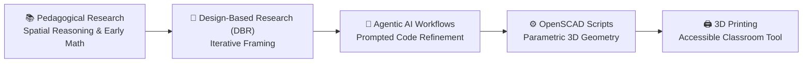

# Parametric Math Manipulatives via EdTech & Agentic AI

> **Bridging Pedagogical Research and Tangible Making — One Parametric Model at a Time**  
> *Independent Research by Dhamodharan KKP*

---

## 📐 Overview: Math Manipulative Baseline Generator

Physical manipulatives are foundational in early mathematics education, fostering spatial reasoning, numerical intuition, and tactile comprehension. However, off-the-shelf plastic manipulatives are often static, costly, or misaligned with specific empirical interventions.

The **Math Manipulative Baseline Generator** is an open-source, code-driven design framework developed to bridge educational research and physical digital fabrication:

---

## 🔬 Design-Based Research (DBR) Framework

Rather than starting from a blank design canvas, the development workflow is structured directly through:
1. **Academic Literature Analysis:** Reviewing peer-reviewed studies on spatial reasoning, cognitive load theory, and tactile learning interventions.
2. **Empirical Translation:** Translating theoretical spatial concepts into precise geometric constraints (tolerances, interlocking chamfers, tactile textures).
3. **Iterative Field Validation:** Testing 3D-printed prototypes with learners and educators to evaluate usability, durability, and pedagogical effectiveness.

---

## 🤖 Agentic AI & OpenSCAD Computational Pipeline

Traditional CAD modeling can become a bottleneck when exploring dozens of parametric variations for diverse age groups and grip sizes. This project uses **Agentic AI workflows** to accelerate the generative cycle:

* **Code-First CAD (OpenSCAD):** Utilizing programmatic geometry where dimensions, grid arrays, step angles, and tolerance offsets are exposed as dynamic variables.
* **Agentic Optimization:** AI agents assist in:
  * Automating parameter adjustments based on specified learning objectives.
  * Optimizing OpenSCAD code modularity and boolean geometry trees.
  * Generating customizable presets for diverse pedagogical tiers (e.g., fractional blocks, geometric tangrams, base-ten rods).
* **Rapid Prototyping:** Direct compilation into STL/3MF formats for FDM desktop 3D printing with eco-friendly recycled PLA.

---

## 🎯 Impact & Open Science Goals

* **Zero-Cost Customization:** Enabling teachers and makerspaces to tailor manipulative dimensions according to classroom needs.
* **Open Source Hardware (OSH):** Releasing all code and print profiles openly under open educational licenses.
* **Democratizing STEM Tools:** Allowing rural and underfunded schools with a single desktop 3D printer to produce high-quality, customized math kits locally.

---

## 🔗 Project Updates & Documentation

* **LinkedIn Research Note:** [Read the Discussion on LinkedIn](https://lnkd.in/p/g8j_RRwu)
* **Status:** Active development & documentation phase.
