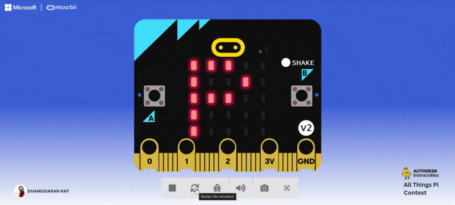
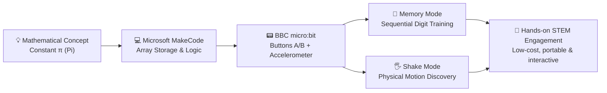

# Instructables & DIY Maker Projects

> **Open-hardware tutorials, microcontroller physical computing, and hands-on STEM learning games published on Autodesk Instructables.**

---

## 🛠️ DIY Maker Projects Overview

Welcome to the **Instructables & DIY Maker Projects** showcase. This section documents step-by-step physical computing and maker projects published on **Autodesk Instructables**, bridging computational thinking, microcontroller sensors, and interactive game design.

Each project is designed with low barriers to entry, utilizing accessible components like the **BBC micro:bit**, visual block coding in **Microsoft MakeCode**, and open educational resources that teachers and makerspaces can replicate immediately.

---

## 🕹️ Featured Instructables

### [Pi Master Challenge – Interactive Micro:bit STEM Game for Learning Pi](instructables/pi-master-challenge.md)

* **Platform:** BBC micro:bit & Microsoft MakeCode (Block Coding / JavaScript).
* **Published Guide:** [Instructables Tutorial Link](https://www.instructables.com/Pi-Master-Challenge-Interactive-Microbit-STEM-Game/)
* **Live Project Remix:** [MakeCode Project (S35012-79536-47475-70009)](https://makecode.microbit.org/S35012-79536-47475-70009)
* **Project Concept:** Transforms the mathematical constant $\pi$ (Pi) from abstract, rote memorization into an interactive physical game with two distinct modes:
  * **Memory Mode (`MEM`):** Displays sequential Pi digits across the $5 \times 5$ LED matrix for visual retention and practice.
  * **Shake Mode (`SHK`):** Uses the onboard accelerometer so learners discover consecutive digits ($3 \to 1 \to 4 \to 1 \to 5 \dots$) through physical motion.
* **Key Learning Outcomes:** Sequence recognition, array indexing, conditional control flow, accelerometer integration, and embodied mathematics.

👉 [**View Full Step-by-Step Instructables Tutorial & Code Guide →**](instructables/pi-master-challenge.md)

---

## 📐 Maker Architecture

---

## 🔗 Related Sections
* [**Tinkering & Creative Coding**](../tinkering/turtle-art/turtle-art.md) — CodeAI facilitator training, OctoStudio mobile sensor computing, and Turtle Art.
* [**Toy Designs, Products & EdTech Manipulatives**](../toy-designs-and-products.md) — Tangible kinetic toys, Numicon math manipulatives, and Tamil mensuration solids.
