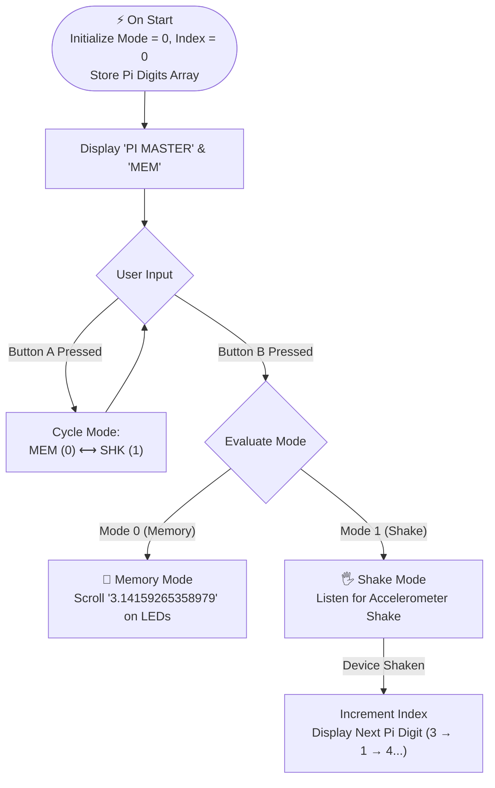

# Pi Master Challenge – Interactive Micro:bit STEM Game for Learning Pi

> **Transforming the abstract mathematical constant $\pi$ into an active hands-on STEM game using the BBC micro:bit and Microsoft MakeCode.**  
> *Published by Dhamodharan KKP on [Autodesk Instructables](https://www.instructables.com/Pi-Master-Challenge-Interactive-Microbit-STEM-Game/)*

---

## 📸 Project Showcase

*Live demonstration of the Pi Master Challenge running on the BBC micro:bit LED matrix display.*

* **Official Instructables Article:** [Pi Master Challenge on Instructables](https://www.instructables.com/Pi-Master-Challenge-Interactive-Microbit-STEM-Game/)
* **Live Microsoft MakeCode Project:** [makecode.microbit.org/S35012-79536-47475-70009](https://makecode.microbit.org/S35012-79536-47475-70009)

---

## 🎯 Introduction & Pedagogical Need

**$\pi$ (Pi)** is one of the most recognized mathematical constants in the world, yet for many learners it remains abstract, difficult to memorize, and disconnected from real-world engagement. In standard classroom settings, learning Pi often boils down to passive rote memorization of digits.

The **Pi Master Challenge** transforms Pi into an active hands-on game by combining physical buttons, motion sensing (accelerometer), and visual feedback on a low-cost microcontroller.

---

## 🕹️ System Architecture & Game Modes

---

## 🛠️ Step-by-Step Construction Guide

### Step 1: Create Variables in MakeCode
Before programming the logic, create the following core variables in **Microsoft MakeCode**:
* Navigate to **Variables** $\longrightarrow$ **Make a Variable**
  * `mode` — Stores the active game mode (`0` = Memory Mode, `1` = Shake Mode).
  * `index` — Tracks the current position in the sequence of Pi digits.
  * `piDigits` — An array storing the decimal digits of Pi.

---

### Step 2: Setup on Start
In the `on start` block, initialize the system state and populate the Pi digit array:
1. `set mode to 0`
2. `set index to 0`
3. `set piDigits to array of [3, 1, 4, 1, 5, 9, 2, 6, 5, 3, 5, 8, 9, 7, 9]`
4. `show string "PI MASTER"`
5. `show string "MEM"`

---

### Step 3: Program Button A (Mode Switch)
Button A allows the player to cycle between the two operating modes:
* When **Button A is pressed**:
  * `change mode by 1`
  * `if mode > 1 then set mode to 0`
  * Check `if mode = 0 then show string "MEM"`
  * Check `if mode = 1 then show string "SHK"`

---

### Step 4: Program Button B (Launch Selected Mode)
Button B starts the selected game mode:
* When **Button B is pressed**:
  * `if mode = 0 then:`
    * `show string "MEMORY"`
    * `show string "3.14159265358979"`
  * `if mode = 1 then:`
    * `show string "SHAKE"`

---

### Step 5: How to Play
* **🧠 Memory Mode (`MEM`):**
  1. Press **Button A** until `MEM` appears on the screen.
  2. Press **Button B** to start.
  3. The micro:bit scrolls the consecutive digits of $\pi$ across the LED display for visual memorization.
* **🖐️ Shake Mode (`SHK`):**
  1. Press **Button A** until `SHK` appears.
  2. Press **Button B** to start.
  3. Shake the micro:bit physically. Each shake triggers the internal 3-axis accelerometer and reveals the next digit in the sequence: $3 \longrightarrow 1 \longrightarrow 4 \longrightarrow 1 \longrightarrow 5 \dots$

---

## 🎓 Learning Outcomes
This project supports multiple pedagogical dimensions across K–12 STEM education:
* **Spatial & Sequential Memory:** Translates numerical sequences into tactile, rhythmic physical interactions.
* **Array Indexing & Data Structures:** Hands-on demonstration of zero-indexed data arrays (`piDigits[index]`).
* **Conditional Logic & State Machines:** Understanding mode toggling (`mode = 0` vs `mode = 1`) through hardware button events.
* **Physical Computing & Sensor Inputs:** Experiencing how hardware accelerometers convert kinetic human motion into programmatic triggers.

---

## ⚡ Why BBC Micro:bit?
The BBC micro:bit is an exceptional platform for rapid educational prototyping:
* **$5 \times 5$ LED Matrix:** Built-in display eliminates the need for external screens or breadboards.
* **Onboard Accelerometer:** Enables motion-controlled physical gaming right out of the box.
* **Accessible Coding:** Accessible via drag-and-drop MakeCode blocks, JavaScript, or MicroPython.
* **Battery Portability:** Allows learners to carry their game around for peer challenges.

---

## 🚀 Future Roadmap & Upgrades
* **Timed Challenge Mode:** Incorporating a countdown timer where players must enter digits before the clock expires.
* **Buzzer / Audio Tones:** Emitting unique pitch frequencies for correct or incorrect digit inputs.
* **Multiplayer Duels:** Using micro:bit radio broadcast packets to allow two players to compete head-to-head.
* **3D Printed Protective Case:** Fabricating custom snap-fit enclosures on an FDM 3D printer.

---

## 💻 Explore, Remix & MakeCode Project

The complete code is open-source and free to remix. Test the project directly in your browser or flash it onto your micro:bit:

👉 **[Open Live MakeCode Project (S35012-79536-47475-70009)](https://makecode.microbit.org/S35012-79536-47475-70009)**

