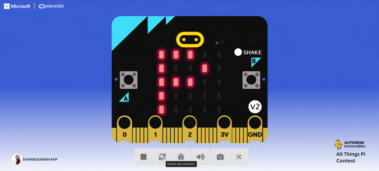
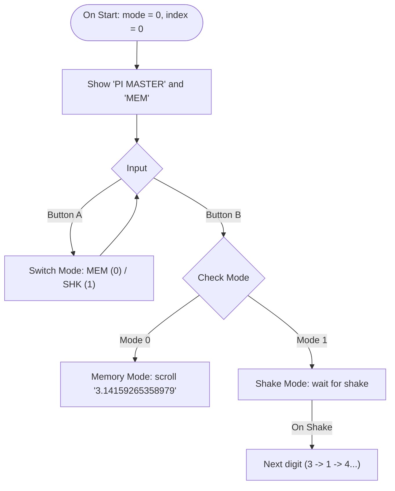
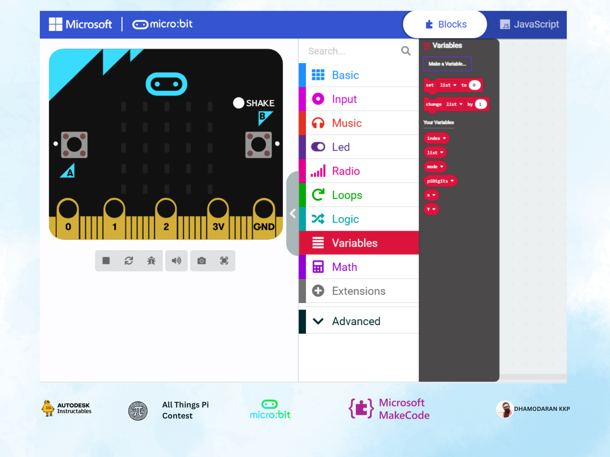
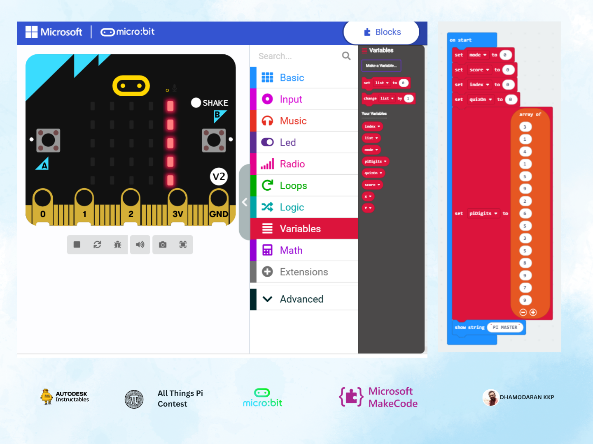
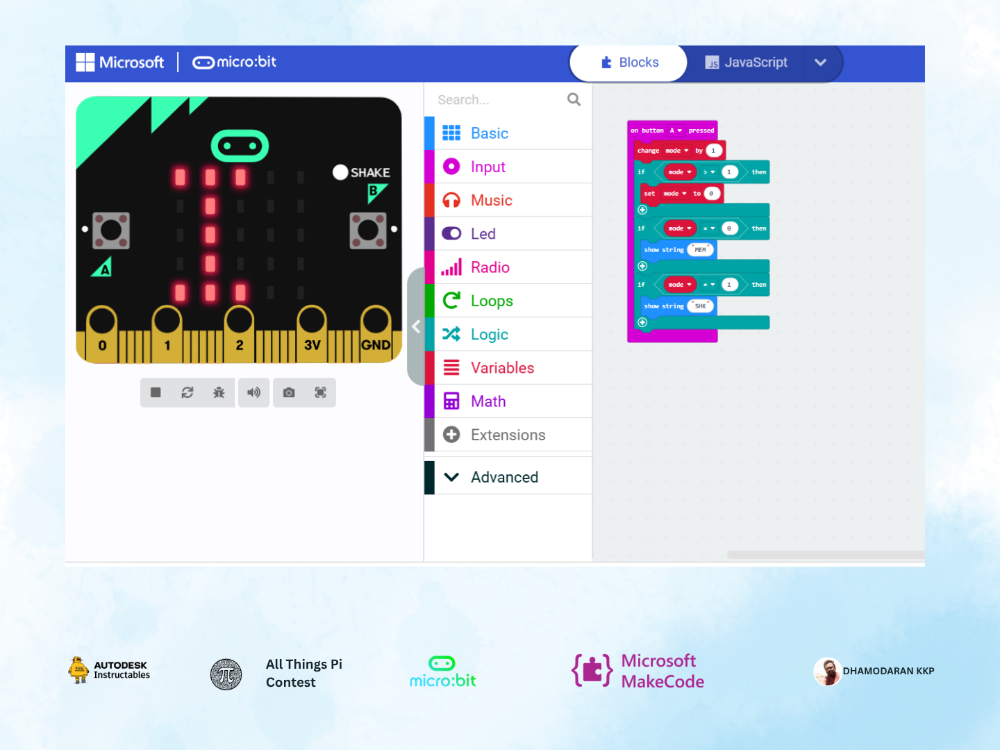
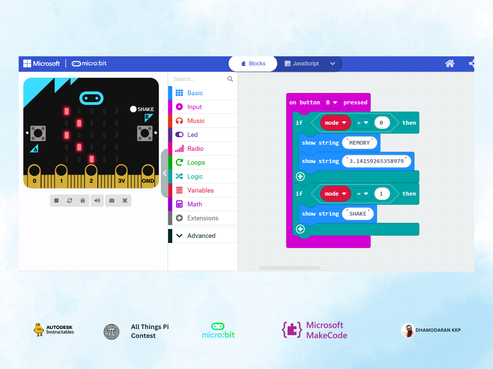
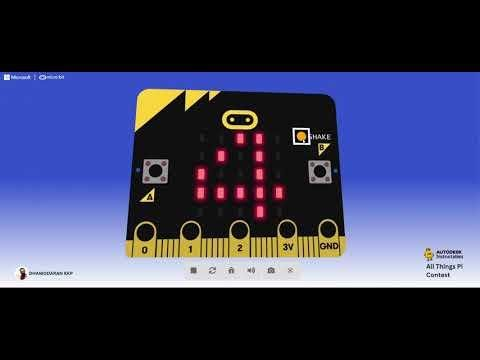
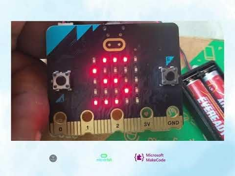

# Pi Master Challenge – Interactive Micro:bit STEM Game for Learning Pi

*Published by Dhamodharan KKP on [Autodesk Instructables](https://www.instructables.com/Pi-Master-Challenge-Interactive-Microbit-STEM-Game/)*

---

## Project Preview

* **Instructables Guide:** [Pi Master Challenge on Instructables](https://www.instructables.com/Pi-Master-Challenge-Interactive-Microbit-STEM-Game/)
* **Live MakeCode Project:** [makecode.microbit.org/S35012-79536-47475-70009](https://makecode.microbit.org/S35012-79536-47475-70009)

---

## Introduction

$\pi$ (Pi) is one of the most well-known numbers in math, yet for many learners it feels abstract and hard to remember beyond `3.14`. I built **Pi Master Challenge** on a **BBC micro:bit** to turn learning Pi digits into a quick, hands-on game using physical buttons, motion sensing, and the $5 \times 5$ LED display.

---

## How It Works

---

## Step-by-Step Build

### Step 1: Create Variables in MakeCode
Open **Variables → Make a Variable** in Microsoft MakeCode and create:
* `mode` — Tracks the active game mode (`0` = Memory, `1` = Shake).
* `index` — Tracks which digit of Pi is currently shown.
* `piDigits` — An array storing the digits of Pi.

---

### Step 2: Setup on Start
Inside `on start`:
1. `set mode to 0`
2. `set index to 0`
3. `set piDigits to array of [3, 1, 4, 1, 5, 9, 2, 6, 5, 3, 5, 8, 9, 7, 9]`
4. `show string "PI MASTER"`
5. `show string "MEM"`

---

### Step 3: Program Button A (Mode Switch)
Button A cycles between `MEM` and `SHK`:
* `change mode by 1`
* `if mode > 1 then set mode to 0`
* `if mode = 0 then show string "MEM"`
* `if mode = 1 then show string "SHK"`

---

### Step 4: Program Button B (Start Mode)
Button B starts whichever mode is selected:
* `if mode = 0`: `show string "MEMORY"`, then `show string "3.14159265358979"`
* `if mode = 1`: `show string "SHAKE"`

---

### Step 5: How to Play
* **Memory Mode (`MEM`):** Press **A** until `MEM` appears, then press **B** to watch the digits scroll across the LED matrix.
* **Shake Mode (`SHK`):** Press **A** until `SHK` appears, press **B**, and shake the micro:bit to reveal each digit in sequence ($3 \to 1 \to 4 \to 1 \to 5 \dots$).

---

## Learning Outcomes & Hardware Notes

* **Concepts Practiced:** Arrays and indexing (`piDigits[index]`), conditional state switching, and reading accelerometer shake events.
* **Why Micro:bit:** The onboard $5 \times 5$ LED matrix, buttons, and accelerometer make it portable and quick to prototype without external wiring.
* **Future Ideas:** Score tracking, countdown timer, buzzer sound effects, multiplayer radio mode, and a 3D-printed protective case.

---

## Explore & Remix

You can open, test, or remix the blocks directly in MakeCode:

[Open MakeCode Project (S35012-79536-47475-70009)](https://makecode.microbit.org/S35012-79536-47475-70009)

