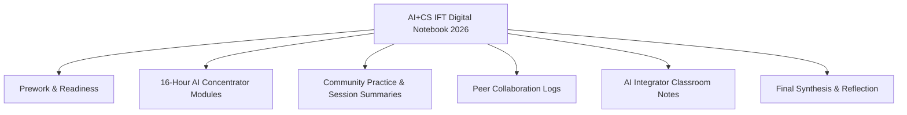

# CodeAI International Facilitator Training 2026 & Mentorship

*Documented by Dhamodharan KKP — Independent Researcher & Certified CodeAI Facilitator*

---

## Credentials & Certifications

### 1. Certified CodeAI Facilitator (October 2026)
* **Issuing Organization:** CodeAI ([code.org](https://code.org))
* **Credential:** Certified CodeAI Facilitator — *AI Concentrator Facilitator Track*
* **Certificate ID:** `IFT26-029` (Verification: `felipe.fontecilla@code.org`)
* **Authorized Signatory:** Karim Meghji — *President and CEO, CodeAI*
* **Certificate PDF:** [`IFT26-029_Dhamodharan_K.pdf`](../../../assets/certificates/IFT26-029_Dhamodharan_K.pdf)

| Module / Workshop | Hours | Focus |
| :--- | :--- | :--- |
| **Facilitator 101 Workshop** | 10h | Cohort leadership, synchronous/self-paced coaching, and pedagogical scaffolding. |
| **CodeAI Pedagogy – International Course** | 2h | Universal Design for Learning (UDL), culturally responsive computing, and inquiry-based AI pedagogy. |
| **Dance Party: AI Edition** | 1h | Creative coding combining music, choreography logic, and generative AI effects. |
| **AI for Oceans** | 1h | Machine learning classification, dataset bias, and marine ecology examples. |
| **Mix & Move with AI** | 2h | Body tracking, computer vision heuristics, and movement-based computing. |

---

### 2. Vivo Ignite 2026 — Mentor Certificate of Appreciation
* **Issuing Organizations:** Shooting Stars Foundation & Mango Education
* **Role:** Mentor in Vivo Ignite 2026
* **Authorized Signatory:** R. Obuli Chandran — *CEO, Mango Education*
* **Summary:** Recognized for guiding student participants to refine their ideas, build functional prototypes, and prepare presentation videos for the national evaluation.
* **Certificate PDF:** [`Dhamodharan - Vivo Ignite 2026 - Mentoring Certificate.pdf`](../../../assets/certificates/Dhamodharan%20-%20Vivo%20Ignite%202026%20-%20Mentoring%20Certificate.pdf)

---

## Digital Portfolio & Facilitator Evidence

Curriculum notes, session summaries, and peer collaboration logs are archived in the **[Dhamodaran K AI+CS IFT - CodeAI Google Drive Workspace](https://drive.google.com/drive/folders/18Y4511_XjzenXn3xjKDwxcJ0xXUFTCt8?usp=drive_link)**:

### Key Archive Documents
1. **AI+CS IFT Digital Notebook - 2026:** Learning milestones, reflections, and lesson plans.
2. **Evidence — AI Integrator Documents (7.2 MB):** Notes on introducing prompt design and machine learning tools in K–12 settings.
3. **Evidence — Community Practice & Session Summaries:** Records from sessions connected with **Aarvam Learning Lab**, **Payir**, and **Amagi Foundation**.
4. **Evidence — Peer Collaboration Documents:** Co-design notes and curriculum feedback across the international facilitator cohort.
5. **Asynchronous Modules & Attendance Log:** Verification of workshops, meetups, and coursework.
6. **Final Reflection Document:** Notes on adapting international AI literacy activities into bilingual (Tamil & English) makerspace materials for rural Tamil Nadu.
