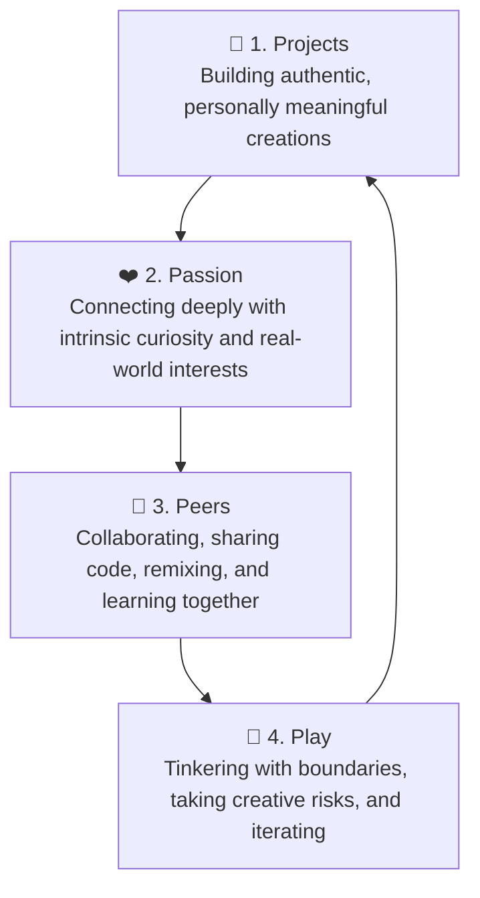

# OctoStudio & Creative Coding: MIT Media Lab LCL Reflection

> **Designing, Tinkering, and Learning Through Play**  
> *Facilitated & Documented by Dhamodharan KKP — Makerspace Educator at Aarvam Learning Lab*

---

## 🌟 Introduction & The MIT Media Lab LCL Community

Over recent months, I participated in the **Lifelong Kindergarten (LCL)** learning community hosted by the **MIT Media Lab** ([lcl.media.mit.edu](https://lcl.media.mit.edu/)). 

LCL is an international community of creative educators, researchers, designers, and makers exploring constructionist learning environments. Grounded in the philosophy of Seymour Papert and Mitchel Resnick, the experience focused on:
* **Shifting from Consumers to Creators:** Moving learners away from passively consuming digital apps toward utilizing computational tools as a dynamic medium for self-expression, storytelling, and problem solving.
* **Cultivating Creative Learning Environments:** Establishing spaces where curiosity is celebrated, playful experimentation is encouraged, and failure is treated as an essential stepping stone of the iterative design cycle.

---

## 🧩 The 4 Ps of Creative Learning: In-Depth Practice

The **4 Ps of Creative Learning** formed the backbone of every activity and workshop:

### 1. Projects (செயல்திட்டங்கள்)
* Rather than completing isolated, formulaic exercises, learners work on continuous, open-ended projects.
* Examples include interactive animated folk stories, mobile sensor games, automated bio-monitoring tools, and kinetic physical toys.

### 2. Passion (ஆர்வமும் ஈடுபாடும்)
* When learners care deeply about what they are creating, they persist through complex debugging and technical obstacles.
* Bridging individual passions—such as local bird-watching, mechanical gearing, origami, or regional folklore—into digital and physical making.

### 3. Peers (சக கற்றல் மற்றும் சமூகம்)
* Learning flourishes as a social activity. 
* Through code-sharing, peer code reviews, and physical showcase exhibitions, learners give and receive constructive feedback, discovering new techniques by remixing their peers' work.

### 4. Play (விளையாட்டு வழி கற்றல்)
* Play is viewed as an attitude: playful experimentation, testing limits, tinkering with unknown variables, and celebrating unexpected discoveries.

---

## 📱 OctoStudio: Mobile-First Creative Computation

[OctoStudio](https://octostudio.org/) is a mobile creative coding application developed by the Lifelong Kindergarten group at the MIT Media Lab. It is specifically designed to bring code off the desktop and into the physical environment.

### Key Capabilities Explored:
1. **Physical Sensor Integration:**
   * **Accelerometer / Tilt Sensor:** Tilting the phone to steer characters, navigate physics mazes, or trigger kinetic animations.
   * **Microphone & Sound:** Voice-activated animations and sound-reactive game triggers.
   * **Camera & Flash:** Incorporating real-world photos, animated backdrops, and strobing light effects into project sequences.
2. **Offline-First Equity:**
   * Functions entirely without internet connectivity, making it an ideal computational tool for rural schools and low-bandwidth makerspaces.
3. **Cross-Device Storytelling:**
   * Facilitates seamless Bluetooth communication between smartphones, enabling collaborative, multi-device games and interactive group installations.

---

## 🏫 Grounded Practice at Aarvam Learning Lab

As a **Makerspace Educator at Aarvam Learning Lab**, working in close synergy with **Payir**, **Amagi Foundation**, and **Tecplore**, this journey directly translates into rural educational practice:

* **The Creative Learning Spiral in Action:**  
  $$\text{Imagine} \longrightarrow \text{Create} \longrightarrow \text{Play} \longrightarrow \text{Share} \longrightarrow \text{Reflect} \longrightarrow \text{Iterate}$$
* **Nature & Biodiversity Linkages:**  
  Students observe local flora and fauna, log entries onto **iNaturalist**, and then build animated ecological stories in **OctoStudio** featuring the exact organisms they observed in their village surroundings.
* **Low Threshold, High Ceiling, Wide Walls:**  
  * *Low Threshold:* A child can make an animated sprite dance in less than 3 minutes.  
  * *High Ceiling:* Advanced learners can integrate conditional loops, nested timing, and multi-sensor inputs.  
  * *Wide Walls:* The same tool accommodates art, science simulations, music creation, and interactive games.

---

## 📊 Presentation Deck & Documentation

* **Interactive Reflection Slide Deck (Canva):**  
  👉 [Open the Full LCL Reflection Presentation Deck](https://www.canva.com/design/DAHLbPMrO50/7QMMQvmF7IGjDbdlEg5taw/view)  
  *(Comprehensive slide-by-slide visual breakdown of the LCL modules, participant showcases, and pedagogical insights)*
* **LinkedIn Community Reflection & Discussion:**  
  👉 [View LinkedIn Reflection Post & Discourse](https://www.linkedin.com/posts/dhamodarankkp_lcl-reflection-share-7467590616785317888-6njS/)

---

> *"One of my biggest takeaways is that meaningful learning happens when curiosity, creativity, and community come together. As an educator, our role is not to dispense answers, but to construct inviting playgrounds where learners feel empowered to imagine and build."* — **Dhamodharan KKP**
