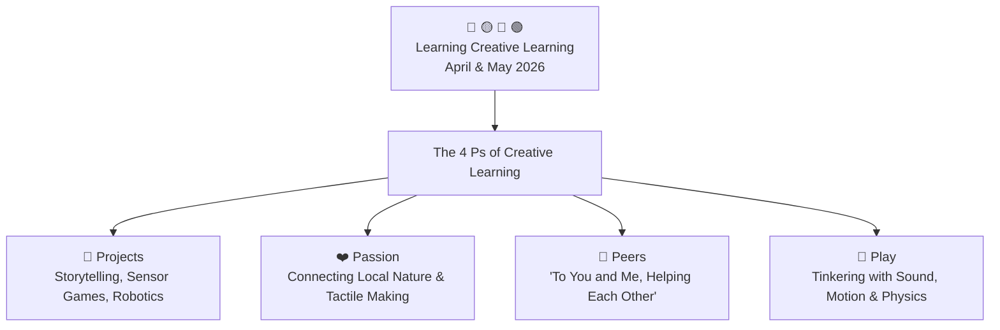

# OctoStudio & Creative Coding: MIT Media Lab LCL Reflection

> **Learning Creative Learning (April & May 2026)**  
> *A four-week journey with community facilitators — Curiosity, creativity, and connection everywhere.*  
> *Facilitated & Documented by Dhamodharan KKP — Independent Researcher & Creative Learning Facilitator*

---

## 🌟 The Lifelong Kindergarten (LCL) Experience

During April & May 2026, I engaged in an intensive four-week journey within the **Learning Creative Learning (LCL)** community facilitated by the **MIT Media Lab** ([lcl.media.mit.edu](https://lcl.media.mit.edu/)).

LCL is an international, peer-driven community of educators, designers, researchers, and tinkerers exploring constructionist pedagogy. The experience shifted computational thinking from a technical exercise into an open playground for **creative expression, storytelling, and human connection**.

---

## 📱 Creative Coding with OctoStudio

[OctoStudio](https://octostudio.org/), developed by the Lifelong Kindergarten group at the MIT Media Lab, was the primary creative vehicle used to explore computational concepts directly on smartphones:

### Key Computational Explorations:
1. **Interactive Storytelling & Animation:**
   * **The Mushroom & Butterfly Garden:** Designing reactive sprite animations with colorful botanical backdrops, integrating nature photography and illustrative art.
   * **Desert & Pyramid Landscapes:** Simulating environmental narratives and dynamic sprite movement across layered scenes.
   * **Character Animation:** Building animated dialogues and expressive character reactions using custom drawn sprites (like playful forest monsters and woodland animals).
2. **Physical Sensor Computing:**
   * **Tilt & Accelerometer Controls:** Steering on-screen elements and navigating obstacles simply by tilting the mobile phone.
   * **Sound & Microphone Reactions:** Animating characters responding in real-time to speech, clapping, and ambient makerspace sound.
   * **Flashlight & Camera Integration:** Triggering digital story events using the phone's physical flash and camera sensors.
3. **Offline Equity in Rural Education:**
   * Operating entirely offline without needing active internet or high-end laptops, empowering children in rural community centers to code directly on shared mobile devices.

---

## 🤝 "To You and Me, Helping Each Other" — The Power of Peer Learning

A central breakthrough during the LCL journey was living out the **Peers** principle through direct collaboration:

* **Collaborative Making & Troubleshooting:** Partnering side-by-side with fellow makers, exploring educational robotics kits, microcontrollers, and sensory tinkering.
* **Peer Feedback Loops:** Sharing raw, unfinished prototypes with the global LCL cohort, learning how other facilitators adapt creative coding prompts for different age groups and cultural backgrounds.
* **Co-Designing Learning Interventions:** Moving away from traditional top-down instruction to peer co-creation, where educators learn alongside their students.

---

## 🦋 Reflecting on My 4 Ps

In my final synthesis on the canvas, I mapped out the evolution across the 4 Ps:

| Dimension | Personal Reflection & Lived Practice |
| :--- | :--- |
| **🎯 Projects** | Began with micro-creativity prompts in OctoStudio, evolving into full animated narratives, sensor-driven games, and physical educational toy prototypes. |
| **❤️ Passion** | Connected personal love for biodiversity, nature observation (via iNaturalist), tactile mechanisms, and rural educational empowerment. |
| **👥 Peers** | Collaborated with local and international educators; co-troubleshot code and hardware; experienced true peer learning through *"Helping Each Other"*. |
| **🎲 Play** | Embraced iterative trial-and-error without fear of syntax errors; explored unexpected animation glitches as creative design features. |

---

## 🏫 Grounded Practice at Aarvam Learning Lab

This journey directly shapes our open pedagogical research framework connected with community initiatives in partnership with **Payir**, **Amagi Foundation**, and **Tecplore**:

1. **The Creative Learning Spiral:**  
   $$\text{Imagine} \longrightarrow \text{Create} \longrightarrow \text{Play} \longrightarrow \text{Share} \longrightarrow \text{Reflect} \longrightarrow \text{Iterate}$$
2. **Nature-Infused Computation:**  
   Frameworks where children explore their local ecology, record bird and plant sightings on **iNaturalist**, and then program interactive animations of those species in **OctoStudio**.
3. **Makerspace Empowerment:**  
   Designing tools that provide rural youth with the agency to imagine, build, and share interactive artifacts with their community.

---

## 🎨 Interactive Artifacts & Presentation Deck

* **Interactive Slide Canvas (Canva):**  
  👉 [Open the Full LCL Reflection Presentation](https://www.canva.com/design/DAHLbPMrO50/7QMMQvmF7IGjDbdlEg5taw/view)
* **LinkedIn Reflection Post & Community Discussion:**  
  👉 [Read the Post & Discussion on LinkedIn](https://www.linkedin.com/posts/dhamodarankkp_lcl-reflection-share-7467590616785317888-6njS/)

---

> *"The biggest insight from LCL: Meaningful learning happens when curiosity, creativity, and community come together. The future of education lies in empowering learners to imagine, create, share, reflect, and iterate."* — **Dhamodharan KKP**
