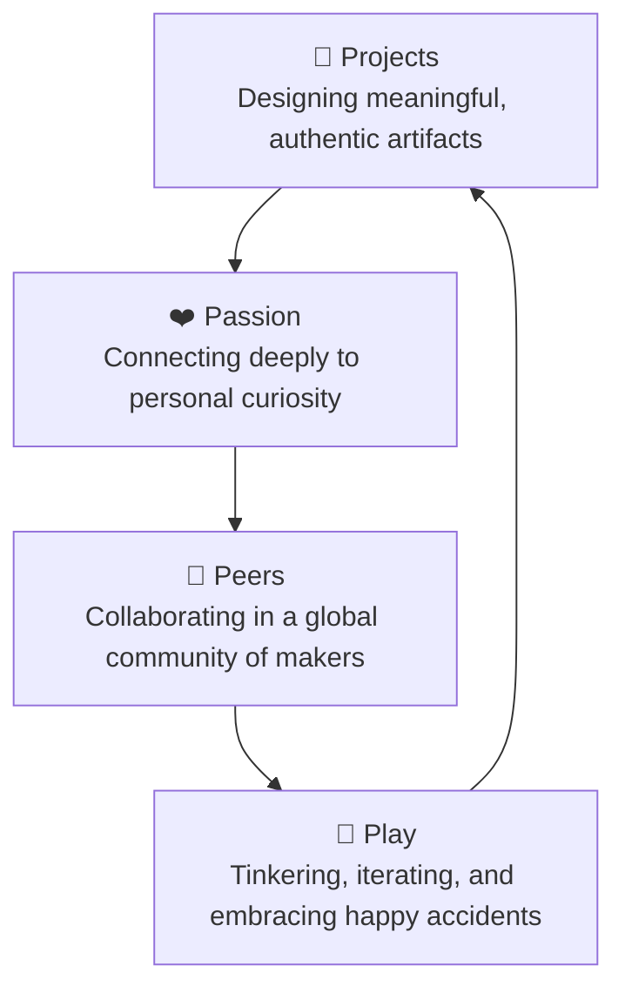

# OctoStudio & MIT Media Lab Lifelong Kindergarten (LCL)

> **Creative Learning by Making, Playing, and Creating**  
> *Facilitated by Dhamodharan KKP — Makerspace Educator at Aarvam Learning Lab*

---

## 🌟 The Lifelong Kindergarten Journey

Over recent months, I had the privilege of actively participating in the **Lifelong Kindergarten (LCL)** learning community hosted by the **MIT Media Lab** ([lcl.media.mit.edu](https://lcl.media.mit.edu/)). 

Through LCL, we explored creative coding with **OctoStudio**, hands-on maker projects, digital storytelling, biodiversity observations (connected with iNaturalist), digital fabrication, physical tinkering, and AI-assisted design workflows. 

The journey reinforced a foundational educational philosophy: **moving beyond passive technology consumption to using technology as a dynamic medium for personal expression, creativity, and collaborative learning.**

---

## 🧩 The 4 Ps of Creative Learning in Practice

The **4 Ps of Creative Learning** pioneered by Prof. Mitchel Resnick and the Lifelong Kindergarten group transformed from theoretical concepts into a daily lived practice:

* **Projects:** Designing and fabricating tangible models, educational toys, and interactive animations that solve real problems or communicate scientific ideas.
* **Passion:** Following intrinsic interests in nature, mathematical patterns, mechanical kinetic toys, and rural STEM equity.
* **Peers:** Exchanging insights, feedback, and remixable code with a global cohort of creative educators, facilitators, and designers.
* **Play:** Experimenting fearlessly with block-based logic, sensor-driven smartphone interactions, and physical materials without fear of failure.

---

## 📱 Creative Coding with OctoStudio

[OctoStudio](https://octostudio.org/) is a mobile creative coding environment developed by the MIT Media Lab that brings computation into the physical world:

* **Sensor-Driven Logic:** Utilizing smartphone tilt sensors, camera, flash, and sound detection to create interactive games and physical computing projects.
* **Offline Accessibility:** Empowering learners in resource-constrained environments without requiring constant internet access.
* **Seamless Sharing:** Exporting projects as interactive stories, animated GIFs, or project packages that peers can open and remix immediately.

---

## 🏫 Practice at Aarvam Learning Lab

As a **Makerspace Educator at Aarvam Learning Lab**, in collaborative synergy with **Payir**, **Amagi Foundation**, and **Tecplore**, this journey directly fuels our on-the-ground interventions:

1. **Empowering Young Makers:** Guiding children to move through the iterative design loop: *Imagine $\rightarrow$ Create $\rightarrow$ Play $\rightarrow$ Share $\rightarrow$ Reflect $\rightarrow$ Iterate*.
2. **Integrating Nature & Tech:** Combining outdoor biodiversity observation (iNaturalist) with digital storytelling and computational art.
3. **Low-Threshold, High-Ceiling Activities:** Designing activities where beginners can get started in seconds while advanced learners can create complex, multi-layered interactive projects.

---

## 📊 Presentation & Reflection Artifacts

* **Interactive Reflection Deck (Canva):** [View the Full LCL Reflection Presentation](https://www.canva.com/design/DAHLbPMrO50/7QMMQvmF7IGjDbdlEg5taw/view)
* **LinkedIn Reflection Post:** [Read the Community Discussion on LinkedIn](https://www.linkedin.com/posts/dhamodarankkp_lcl-reflection-share-7467590616785317888-6njS/)

> *"Meaningful learning happens when curiosity, creativity, and community come together. The future of education lies in empowering learners to imagine, create, share, reflect, and iterate."* — **Dhamodharan KKP**
