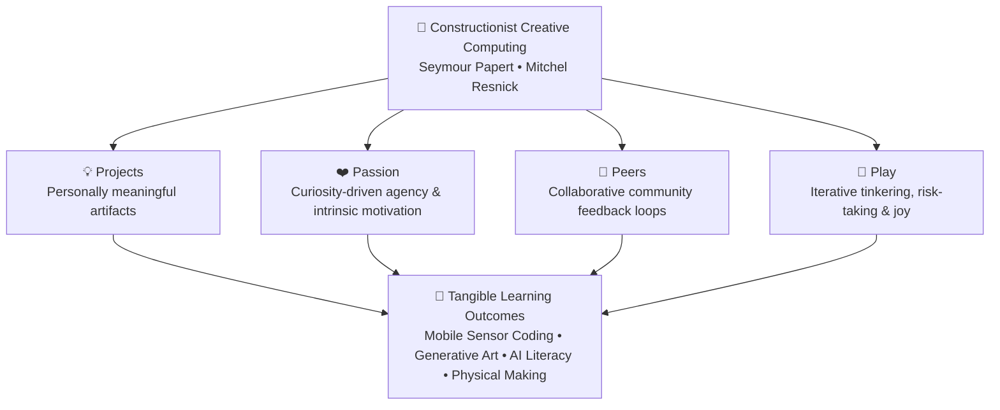

# Tinkering & Creative Coding

> **Exploratory physical computing, computational tinkering, mobile sensor storytelling, and generative mathematical art grounded in constructionist pedagogy.**

---

## 🎨 Creative Computing Overview

Welcome to the **Tinkering & Creative Coding** laboratory portfolio. Grounded in Seymour Papert's **Constructionist learning theory** and the MIT Media Lab Lifelong Kindergarten **4 Ps (Projects, Passion, Peers, Play)** framework, our work explores how learners of all ages can use code as an expressive, personal, and creative medium.

Rather than treating computer science as passive syntax drills, these initiatives bridge code with physical materials, mobile sensors, machine learning intuition, and tangible 3D-printed artifacts.

---

## 🧩 Featured Projects & Initiatives

### 1. [CodeAI Facilitator Training & Evidence](../creative-coding/codeai-ift.md)

* **Credential:** Certified CodeAI Facilitator — *AI Concentrator Facilitator Track (16 Professional Learning Hours)* (ID: `IFT26-029`).
* **National Mentorship:** Mentor for student innovators in **Vivo Ignite 2026** (Mango Education & Shooting Stars Foundation).
* **Pedagogical Pillars:**
  * **Facilitator 101 & Inquiry Pedagogy:** Coaching educators in culturally responsive computing and Universal Design for Learning (UDL).
  * **Dance Party: AI Edition:** Blending choreographic algorithms, musical rhythm, and generative AI effects.
  * **AI for Oceans & Machine Learning:** De-blackboxing machine learning classification, training dataset bias, and ethical environmental modeling.
  * **Mix & Move with AI:** Camera-driven computer vision, body tracking heuristics, and physical movement computing.
* **Classroom Evidence:** Field-tested at **Aarvam Learning Lab** in collaboration with **Payir** and **Amagi Foundation**, developing bilingual (Tamil & English) AI literacy resources for rural schools.

👉 [**Read Full CodeAI Documentation & Portfolio Evidence →**](../creative-coding/codeai-ift.md)

---

### 2. [OctoStudio & MIT Media Lab LCL Reflection](../creative-coding/octostudio-lcl.md)

* **Mobile Physical Computing:** Using **OctoStudio** (MIT Media Lab) to turn smartphones and tablets into expressive computational instruments using built-in hardware sensors (accelerometer, shake, tilt, light, proximity).
* **MIT Lifelong Kindergarten (LCL) Reflection Canvas:**
  * **Projects:** Autonomous learner-driven creative coding without restrictive instruction sheets.
  * **Passion:** Connecting personal interests—from village folklore and interactive puppetry to motion-triggered animations.
  * **Peers:** Collaborative international co-design, asynchronous gallery critique, and local peer learning circles.
  * **Play:** Embracing risk-taking, joyful tinkering, and debugging as creative discovery.
* **Rural Makerspace Integration:** Documenting on-the-ground interventions at **Aarvam Learning Lab** in rural Tamil Nadu, bridging low-barrier mobile tools with community storytelling.

👉 [**Explore the OctoStudio & LCL Reflection Canvas →**](../creative-coding/octostudio-lcl.md)

---

### 3. [Turtle Art – Mathematical Patterns](turtle-art-mathematical-patterns.md)

* **Algorithmic Geometry in Motion:** Using block-based **Turtle Art** where geometry is not drawn statically, but generated through turtle locomotion and angular heading commands.
* **Mathematical Concepts Explored:**
  * **Inner Loop (Repeat 6):** Step displacement with $60^\circ$ turns (exterior angle calculation: $360^\circ / 6 = 60^\circ$) creating regular hexagonal modules.
  * **Outer Loop (Repeat 36):** Incremental $40^\circ$ rotational offsets, synthesizing radial floral symmetries through nested repetition.
* **Code-to-Physical Pipeline:** 
  $$\text{Turtle Art Block Code} \longrightarrow \text{Vector SVG Export} \longrightarrow \text{Tinkercad 3D Modeling} \longrightarrow \text{FDM 3D Printing}$$
* **Tangible Embodiment:** Transforming ephemeral screen pixels into tactile 3D printed reliefs that students can hold, trace, and measure.

👉 [**Read the Turtle Art Mathematical Patterns Guide →**](turtle-art-mathematical-patterns.md)

---

## 🧱 Pedagogical Framework

---

## 🔗 Related Sections
* [**Toy Designs, Products & EdTech Manipulatives**](../../toy-designs-and-products.md) — Tangible kinetic toys, Numicon math manipulatives, and Tamil mensuration solids.
* [**Instructables DIY Tutorials**](../../instructables/instructables.md) — Step-by-step maker tutorials including the *Pi Master Challenge*.
* [**Augmented Reality (AR) & WebXR Overview**](../../ar-webxr-overview.md) — Browser-based spatial computing and educational physics simulations.
