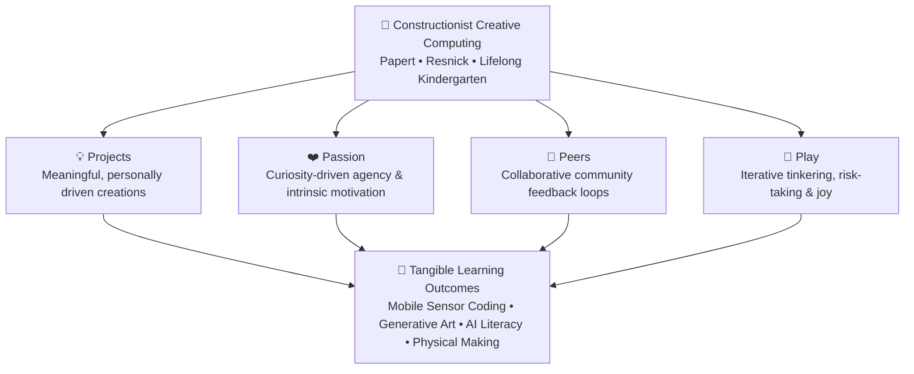

# Tinkering & Creative Coding

> **Exploratory physical computing, computational tinkering, mobile sensor storytelling, and generative mathematical art grounded in constructionist pedagogy.**

---

## 🎨 Creative Computing Overview

Welcome to the **Tinkering & Creative Coding** portfolio. Grounded in Seymour Papert's **Constructionist learning theory** and the MIT Media Lab Lifelong Kindergarten **4 Ps (Projects, Passion, Peers, Play)** framework, our initiatives explore how learners of all ages can use code as an expressive, creative medium rather than a purely mechanical skill.

From mobile sensor coding with **OctoStudio** in rural learning spaces to algorithmic pattern generation in **Turtle Art** and international facilitator coaching with **CodeAI**, this section documents hands-on explorations at the intersection of computing, art, and maker education.

---

## 🧩 Documented Projects & Initiatives

### 1. [CodeAI International Facilitator Training & Mentorship](../creative-coding/codeai-ift.md)
* **Certification:** Certified CodeAI Facilitator (16-Hour AI Concentrator track: *Facilitator 101, CodeAI Pedagogy, Dance Party AI, AI for Oceans, Mix & Move with AI*).
* **Community of Practice:** Classroom deployments, co-teaching protocols, and bilingual learning interventions at **Aarvam Learning Lab** in partnership with **Payir** and **Amagi Foundation**.
* **National Mentorship:** Mentored student innovators in functional prototype engineering and competition pitches for **Vivo Ignite 2026**.

👉 *[Explore the full CodeAI facilitator portfolio and evidence](../creative-coding/codeai-ift.md)*

---

### 2. [OctoStudio & MIT Media Lab Lifelong Kindergarten (LCL) Reflection](../creative-coding/octostudio-lcl.md)
* **Mobile Sensor Computing:** Leveraging built-in smartphone sensors (tilt, shake, light, proximity) to create responsive, screen-transcending physical games and interactive stories.
* **LCL Synthesis Canvas:** Comprehensive reflection across the 4 Ps, personal tinkering journeys, peer collaboration across continents, and grassroots rural learning lab design.
* **Aarvam Learning Lab:** Bringing screen-free and low-barrier creative computing to children and educators in rural Tamil Nadu.

👉 *[Read the complete LCL reflection and OctoStudio case study](../creative-coding/octostudio-lcl.md)*

---

### 3. [Turtle Art – Mathematical Patterns](turtle-art-mathematical-patterns.md)
* **Algorithmic Turtle Geometry:** Programming directional movements, turns, and nested loops to generate complex radial and floral symmetries from simple mathematical rules.
* **From Code to 3D Print:** Converting digital block code into vector graphics (SVG) and importing them into Tinkercad for tangible 3D relief printing.
* **Embodied Geometry:** Helping learners connect abstract angle computations ($360^\circ / n$) with physical, tangible geometry.

👉 *[Explore the Turtle Art mathematical modeling pipeline](turtle-art-mathematical-patterns.md)*

---

## 🧱 Pedagogical Architecture

---

## 🔗 Related Sections
* [**Toy Designs, Products & EdTech Manipulatives**](../../toy-designs-and-products.md) — Tangible kinetic toys, Numicon math manipulatives, and Tamil mensuration solids.
* [**Augmented Reality (AR) & WebXR Overview**](../../ar-webxr-overview.md) — Browser-based spatial computing and educational physics simulations.
