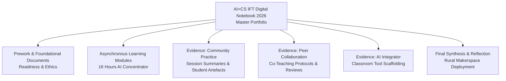

# CodeAI International Facilitator Training 2026 & Mentorship

> **Certified CodeAI Facilitator | AI Concentrator Facilitator Track (16 Hours)**  
> *Facilitated & Documented by Dhamodharan KKP — Independent Researcher & Certified Facilitator*

---

## 🏅 Official Credentials & Certifications

### 1. Certified CodeAI Facilitator (October 2026)
* **Issuing Organization:** **CodeAI** ([code.org](https://code.org))
* **Credential Title:** **Certified CodeAI Facilitator**
* **Track:** **AI Concentrator Facilitator Track**
* **Certificate ID:** `IFT26-029` (Verification: `felipe.fontecilla@code.org`)
* **Authorized Signatory:** **Karim Meghji** — *President and Chief Executive Officer, CodeAI*
* **Certificate Document:** [`IFT26-029_Dhamodharan_K.pdf`](../../assets/certificates/IFT26-029_Dhamodharan_K.pdf)

#### Professional Learning Hours Breakdown (16 Hours Total):
| Module / Workshop | Track Duration | Focus & Competency |
| :--- | :--- | :--- |
| **Facilitator 101 Workshop** | 10 Hours | Live synchronous and self-paced facilitator coaching, cohort leadership, and pedagogical scaffolding. |
| **CodeAI Pedagogy – International Course** | 2 Hours | Universal design for learning (UDL), culturally responsive computing, and inquiry-based AI pedagogy. |
| **Dance Party: AI Edition** | 1 Hour | Interactive creative coding combining music, choreographic algorithms, and generative AI effects. |
| **AI for Oceans** | 1 Hour | Machine learning classification, training dataset bias, ethical data collection, and marine ecology preservation. |
| **Mix & Move with AI** | 2 Hours | Body tracking, computer vision heuristics, and sensor-driven physical computing interventions. |

---

### 2. Vivo Ignite 2026 — Mentor Certificate of Appreciation
* **Issuing Organizations:** **Shooting Stars Foundation** & **Mango Education**
* **Role:** **Mentor in Vivo Ignite 2026**
* **Authorized Signatory:** **R. Obuli Chandran** — *CEO, Mango Education*
* **Citation:** *"In recognition of outstanding contribution as a Mentor in Vivo Ignite 2026. Guidance and expertise were instrumental in helping participants refine their ideas, build functional prototypes, and craft compelling presentation videos for the national evaluation."*
* **Certificate Document:** [`Dhamodharan - Vivo Ignite 2026 - Mentoring Certificate.pdf`](../../assets/certificates/Dhamodharan%20-%20Vivo%20Ignite%202026%20-%20Mentoring%20Certificate.pdf)

---

## 📂 Digital Portfolio & Facilitator Evidence

All operational curriculum notes, community summaries, and peer collaboration logs are archived in the **[Dhamodaran K AI+CS IFT - CodeAI Google Drive Workspace](https://drive.google.com/drive/folders/18Y4511_XjzenXn3xjKDwxcJ0xXUFTCt8?usp=drive_link)**:

### Key Portfolio Documents:
1. **AI+CS IFT Digital Notebook - 2026:** Master portfolio documenting learning milestones, pedagogical reflections, and instructional lesson plans.
2. **Evidence — AI Integrator Documents (7.2 MB):** Deep dive into integrating conversational AI, prompt design, and machine learning models into K-12 learning environments.
3. **Evidence — Community Practice & Session Summaries:** Empirical records from live workshops conducted at **Aarvam Learning Lab** in collaboration with **Payir** and **Amagi Foundation**.
4. **Evidence — Peer Collaboration Documents:** Collaborative co-design records, feedback loops, and peer curriculum reviews across the international facilitator cohort.
5. **Asynchronous Modules & Attendance Log:** Complete verification of synchronous workshops, peer meetups, and asynchronous coursework.
6. **Final Reflection Document:** Roadmap for translating international AI educational standards into accessible, bilingual (Tamil & English) makerspace activities for rural Tamil Nadu.

---

## 🏫 Grounded Classroom Applications at Aarvam Learning Lab

* **AI Literacy Without Black Boxes:** Teaching young students how classifiers work using *AI for Oceans* and physical cards before moving to code.
* **Physical-Digital Synthesis:** Connecting AI concepts directly with physical making—such as parametric OpenSCAD toy generation and OctoStudio sensor interactions.
* **Ethics and Critical Thinking:** Prompting students to interrogate algorithm bias, data collection ethics, and societal implications of artificial intelligence.
