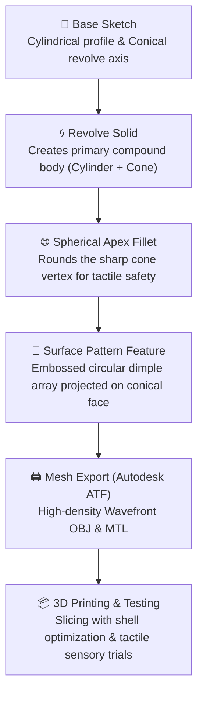

# Tactile Patterned Cone Surface (Sensory Geometric Manipulative)

> **Tactile compound geometric solid with parametric dimpled surface lattice modeled in Autodesk Fusion 360 for sensory learning, mensuration intuition, and additive manufacturing.**  
> *Designed by Dhamodharan KKP — Senior Design Engineer & Additive Manufacturing Researcher*

---

## 📸 Model Preview & CAD Visualization

*Autodesk Fusion 360 design workspace showing the compound solid: smooth cylindrical foundation, patterned conical slant surface, and spherical crown apex.*

---

## 🎯 Design Concept & Pedagogical Motivation

In spatial mathematics and sensory education, students frequently struggle to grasp the differential properties of curved surfaces versus planar surfaces. While a cylinder presents curvature along only one primary axis ($2\pi r h$), a cone combines converging radius with slant height ($l = \sqrt{h^2 + r^2}$), presenting a non-uniform spatial surface ($\pi r l$).

This toy design and tactile manipulative introduces a **multi-sensory geometric artifact** that bridges physical exploration with spatial mathematics:

1. **Tactile Surface Array:** An embossed pattern of micro-nodes / dimples across the conical face enables learners (including visually impaired and kinesthetic learners) to physically "feel" the density gradient as diameter tapers from base to apex.
2. **Compound Solid Architecture:** Directly models textbook mensuration problems involving composite solids (**திண்மங்களின் இணைப்புகள்**)—specifically, a cylinder base, a conical midsection, and a hemispherical/spherical crown.
3. **Child-Safe Ergonomics:** The traditionally sharp, puncturing vertex of a mathematical cone is replaced with a smooth spherical cap, transforming an abstract geometric shape into an ergonomic, graspable sensory toy.

---

## 📐 Geometric & Physical Specifications

| Parameter | CAD Dimension | Architectural Description |
| :--- | :--- | :--- |
| **Total Height ($H_{\text{total}}$)** | 14.02 mm (scalable) | Full vertical height from base to apex |
| **Base Diameter ($2r$)** | 8.00 mm (scalable) | Outer cylindrical diameter |
| **Cylinder Height ($h_1$)** | ~5.50 mm | Smooth foundation for stability and reference |
| **Slant Height ($l$)** | ~7.80 mm | Tapered conical slant hosting surface pattern |
| **Vertex Treatment** | Spherical Cap | Safe rounded apex bead |
| **Surface Pattern** | Circular Lattice | Projected circular nodes along conical face |
| **Mesh Resolution** | 5,634 Vertices / 11,264 Faces | High-fidelity polygonal mesh for smooth 3D printing |

---

## 🛠️ CAD Modeling Workflow in Autodesk Fusion 360

### 1. Primary Revolve & Loft
* The fundamental form is established via a revolved profile incorporating a right circular cylinder at the lower section transitioning into a conical taper with an inclination angle optimized for support-free additive manufacturing (>45° from horizontal).

### 2. Surface Feature Projection
* Micro-features are distributed across the conical face using Fusion 360's cylindrical pattern and projection tools, creating an ordered matrix of tactile nodes that follow the converging curvature of the cone.

### 3. Safety Crown
* The apex is crowned with a smooth spherical cap, eliminating sharp hazard points while introducing a third distinct geometric primitive (Sphere) for comparative volume and surface area exploration.

---

## 🖨️ Design for Additive Manufacturing (DfAM)

* **Supportless Overhangs:** The conical slant angle of ~60° from horizontal naturally exceeds the standard 45° overhang threshold, enabling FDM 3D printing without internal or external support structures on the patterned face.
* **Shell-Dominant Slicing:** As demonstrated in the *Numicon DBR research*, setting 3 to 4 perimeters (shells) ensures that the embossed surface dimples are printed solid, providing crisp tactile feedback without surface delamination.
* **Material Selection:**
  * **Food-Grade PLA / Recycled PLA:** Ideal for educational classroom manipulatives.
  * **TPU / Flexible Filament:** Transforms the solid into a squishable sensory tactile fidget toy for stress relief and early childhood dexterity training.

---

## 📥 Model Asset Downloads

The raw 3D mesh files exported from Autodesk Fusion 360 are preserved in the repository assets:

* [**Wavefront OBJ Model (`cone_surface.obj`)**](../../assets/toy-designs/cone_surface.obj) — 1.5 MB high-resolution mesh (5,634 vertices, 11,264 faces).
* [**Material Definition (`cone_surface.mtl`)**](../../assets/toy-designs/cone_surface.mtl) — Satin steel surface appearance configuration.
* [**Fusion 360 Workspace Screenshot (`cone_surface_fusion360.jpg`)**](../../assets/toy-designs/cone_surface_fusion360.jpg) — Original CAD viewport rendering.

---

## 🔗 Related Projects & Research
* [**Tamil Mensuration 3D Solids (OpenSCAD)**](tamil-mensuration-openscad.md) — Parametric tactile solids for Class 10 Math Chapter 7.
* [**MorphPlay: Circle to Sphere**](morphplay-circle-to-sphere.md) — Kinetic topological toy transforming planar circles to spheres.
* [**Numicon Math Manipulatives**](numicon-math-shapes.md) — DBR classroom manipulative redesign.
