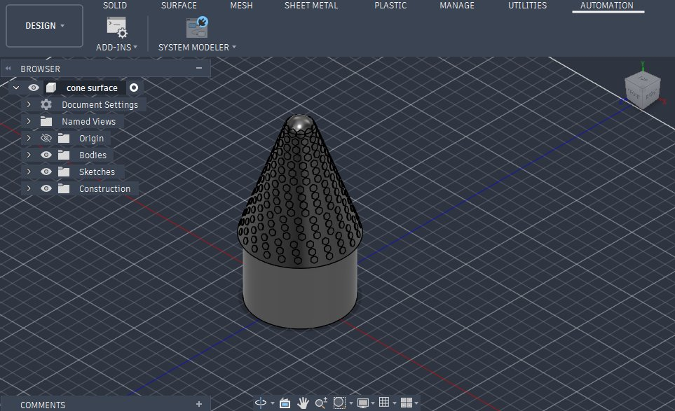

# Tactile Patterned Cone Surface

*Designed by Dhamodharan KKP — Design Contributor & Additive Manufacturing Researcher*

---

## Model Preview

*Autodesk Fusion 360 workspace showing the compound solid: smooth cylindrical base, patterned conical surface, and rounded spherical tip.*

---

## Concept & Purpose

In geometry and mensuration, students often find it hard to see the difference between the curved surface of a cylinder ($2\pi r h$) and that of a cone ($\pi r l$, where slant height $l = \sqrt{h^2 + r^2}$).

This Fusion 360 model turns that comparison into a tactile manipulative:

1. **Textured Conical Face:** An embossed pattern of circular dimples runs along the conical slant surface, letting learners feel how the surface area tapers toward the top.
2. **Compound Solid Form:** Models composite textbook shapes (**திண்மங்களின் இணைப்புகள்**) by combining a cylinder base, a cone midsection, and a spherical cap.
3. **Safe Rounded Tip:** The sharp cone vertex is replaced with a smooth sphere so it is safe and comfortable to handle.

---

## Dimensions & Mesh Specs

| Parameter | Value | Notes |
| :--- | :--- | :--- |
| **Total Height ($H_{\text{total}}$)** | 14.02 mm (scalable) | Base to spherical apex |
| **Base Diameter ($2r$)** | 8.00 mm (scalable) | Outer cylinder diameter |
| **Cylinder Height ($h_1$)** | ~5.50 mm | Smooth reference base |
| **Slant Height ($l$)** | ~7.80 mm | Tapered conical face with pattern |
| **Vertex Treatment** | Spherical Cap | Rounded safety tip |
| **Mesh Resolution** | 5,634 Vertices / 11,264 Faces | Exported via Autodesk ATF |

---

## Fusion 360 Modeling & 3D Printing Notes

* **Revolve & Cap:** Built from a revolved base profile combining the cylinder and cone, with a spherical fillet at the apex.
* **Surface Pattern:** Circular features projected and patterned around the conical face.
* **Support-Free Printing:** The ~60° conical angle prints cleanly on FDM printers without needing external supports on the textured face.
* **Slicing & Materials:** Using 3–4 perimeter shells keeps the surface dimples crisp in **PLA** (for rigid classroom models) or **TPU** (for a soft sensory version).

---

## Model Files

* [**Wavefront OBJ (`cone_surface.obj`)**](../../assets/toy-designs/cone_surface.obj) — 1.5 MB mesh (5,634 vertices, 11,264 faces).
* [**Material File (`cone_surface.mtl`)**](../../assets/toy-designs/cone_surface.mtl) — Satin steel appearance.
* [**Fusion 360 Screenshot (`cone_surface_fusion360.jpg`)**](../../.gitbook/assets/cone_surface_fusion360.jpg)

---

## Related Projects
* [**Tamil Mensuration 3D Solids (OpenSCAD)**](tamil-mensuration-openscad.md)
* [**MorphPlay: Circle to Sphere**](morphplay-circle-to-sphere.md)
* [**Numicon Math Manipulatives**](numicon-math-shapes.md)
