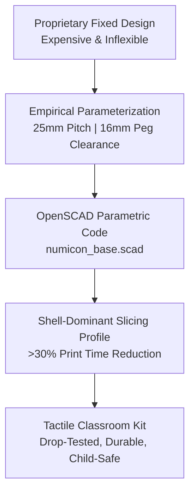

# Numicon Math Manipulatives: DBR Redesign & OpenSCAD Slicing Framework

> **Open-Source Tactile Mathematics: Shapes 1–10 Redesign for Local Classroom Fabrication**  
> *Design-Based Research (DBR) by Dhamodharan KKP*

---

## 📌 Project Overview

The **Numicon mathematical system** converts abstract arithmetic, parity, and spatial relationships into visual, embodied, and tactile geometric tiles. While commercial injection-molded sets are widely acclaimed for foundational numeracy, their high acquisition cost and supply chain barriers limit adoption in underfunded and rural classrooms.

This project documents the **Design-Based Research (DBR)** redesign of the complete Numicon set (Shapes 1 through 10) for localized, affordable fabrication using desktop 3D printers (FDM) and parametric code.

---

## 📐 Baseline Geometry & Modular Architecture

Every tile is algorithmically derived through rigid geometric rules in [`numicon_base.scad`](https://drive.google.com/drive/folders/1GpIaX13v2MOC7LAw96oEf7s7E3aVoM_F):

| Parameter | Dimension | Engineering Rationale |
| :--- | :--- | :--- |
| **Grid Unit Pitch** | $25.0\text{ mm} \times 25.0\text{ mm}$ | Optimized for primary school ergonomic grip and spatial modularity. |
| **Counter / Peg Hole Diameter** | $16.0\text{ mm}$ ($+0.25\text{ mm}$ offset) | Dynamic clearance offset ensuring effortless peg insertion and removal without binding. |
| **Tile Thickness** | $10.0\text{ mm}$ | Provides tactile stability and prevents warping during classroom handling. |
| **Internal Fillets** | $R = 1.2\text{ mm}$ | Alleviates notch stress concentrations at intersection corners under cantilever impacts. |
| **Even/Odd Parity Logic** | Symmetrical 2-column array | Even shapes (2, 4, 6, 8, 10) form dual columns; odd shapes (1, 3, 5, 7, 9) feature top-right unit tabs. |

---

## ⚙️ High-Efficiency Slicing Profile

Standard solid prints with 20%–30% grid infill lead to excessive manufacturing times and brittle failure when dropped on hard classroom floors. By developing a **shell-dominant slicing profile**, we achieved:

* **Print Time Reduction:** Over **30% faster production time** per full 10-piece set.
* **Impact Toughness:** Increased perimeter walls (3–4 perimeters) and 12% gyroid infill dissipate impact energy across the outer shell, surviving repeated 1.5 m drop tests onto concrete floors.
* **Eco-Material Efficiency:** Uses 100% biodegradable, recycled PLA filament with zero harmful off-gassing.

---

## 🤖 Agentic AI CAD Workflow

Using a multi-agent iteration loop (CAD Modifier Agent + Engineering Critic Agent), the OpenSCAD code was iteratively refined:
1. **Automated Fillet Injection:** Inserting stress-relieving fillets on odd-numbered extension tabs.
2. **Tolerance Calibration:** Auto-adjusting hole offsets based on specific 3D printer nozzle extrusion width (0.4 mm vs 0.6 mm).
3. **Anti-Slip Base Pockets:** Incorporating recessed underside pockets for optional magnetic or silicone feet.

---

## 🔗 Project Resources
* **CAD Source:** `cad/numicon_base.scad` & STL models (Shapes 1–10) in [DD Research Drive](https://drive.google.com/drive/folders/1GpIaX13v2MOC7LAw96oEf7s7E3aVoM_F)
* **Full Research Document:** [Numicon Case Study Deep Dive](../../research/numicon-case-study.md)
* **License:** Creative Commons Attribution-NonCommercial-ShareAlike 4.0 (CC BY-NC-SA 4.0)
