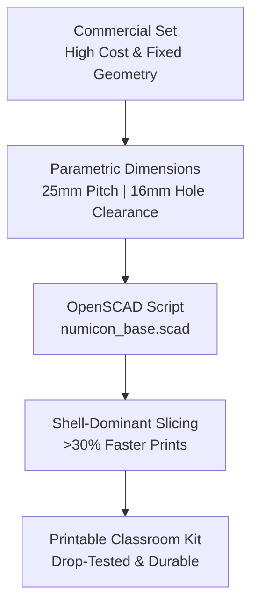

# Numicon Math Manipulatives: DBR Redesign & OpenSCAD Slicing Framework

*Design-Based Research (DBR) by Dhamodharan KKP*

---

## Overview

The **Numicon** system turns basic arithmetic, odd/even parity, and number relationships into physical, interlocking geometric tiles. Commercial injection-molded sets are great for early math, but their price and import costs make them hard to get in many rural and underfunded schools.

This project documents an open-source **Design-Based Research (DBR)** redesign of the 1–10 Numicon set so any school or makerspace can print durable tiles locally on a standard desktop FDM 3D printer using parametric OpenSCAD code.

---

## Geometry & Dimensions

Every tile is generated from shared parameters in [`numicon_base.scad`](https://drive.google.com/drive/folders/1GpIaX13v2MOC7LAw96oEf7s7E3aVoM_F):

| Parameter | Dimension | Design Reason |
| :--- | :--- | :--- |
| **Grid Unit Pitch** | $25.0\text{ mm} \times 25.0\text{ mm}$ | Comfortable size for primary school hands and consistent stacking. |
| **Peg Hole Diameter** | $16.0\text{ mm}$ ($+0.25\text{ mm}$ offset) | Clearance tolerance so pegs slide in and out easily without sticking. |
| **Tile Thickness** | $10.0\text{ mm}$ | Rigid enough to handle rough classroom use without warping. |
| **Internal Fillets** | $R = 1.2\text{ mm}$ | Reduces corner stress and prevents cracking during drops. |
| **Odd / Even Parity** | 2-column grid | Even shapes (2, 4, 6, 8, 10) form flat pairs; odd shapes (1, 3, 5, 7, 9) have a single top-right tab. |

---

## Slicing Profile & Durability

Printing tiles with standard 20%–30% grid infill wastes time and leaves thin walls that crack when dropped on concrete classroom floors. Using a **shell-dominant slicing profile** gave better results:

* **Faster Print Time:** Cut total print time by **over 30%** per full 1–10 set.
* **Drop Resistance:** Using 3–4 outer walls (perimeters) with 12% gyroid infill absorbs impact along the outer shell, surviving repeated 1.5 m drops onto hard floors.
* **Material:** Printed with biodegradable / recycled PLA filament.

---

## Iterative CAD Refinements

Using an AI-assisted CAD review loop (iterating between design edits and printability checks), the OpenSCAD code was updated with:
1. **Corner Fillets:** Added stress-relief fillets on the odd-numbered top tabs.
2. **Nozzle Calibration:** Parameterized hole offsets to account for different nozzle widths (0.4 mm vs 0.6 mm).
3. **Underside Pockets:** Added optional recesses on the bottom for small magnets or anti-slip pads.

---

## Project Files

* **CAD Source:** `cad/numicon_base.scad` and STL files (Shapes 1–10) in [DD Research Drive](https://drive.google.com/drive/folders/1GpIaX13v2MOC7LAw96oEf7s7E3aVoM_F)
* **Full Case Study:** [Numicon Case Study Deep Dive](../../research/numicon-case-study.md)
* **License:** Creative Commons Attribution-NonCommercial-ShareAlike 4.0 (CC BY-NC-SA 4.0)
