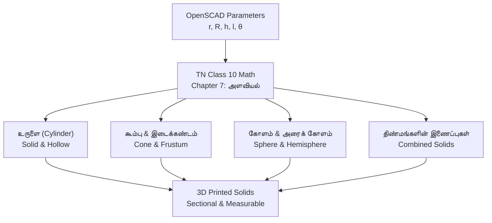

# Tamil Mensuration 3D Solids (அளவியல்) via OpenSCAD & 3D Printing

*Developed by Dhamodharan KKP — Independent Researcher & Design Contributor*

---

## Project Context

In the Tamil Nadu State Board (Samacheer Kalvi) Class 10 Mathematics syllabus, **Chapter 7: Mensuration (அளவியல்)** covers **Curved Surface Area (வளைபரப்பு - CSA)**, **Total Surface Area (மொத்தப் புறப்பரப்பு - TSA)**, and **Volume (கனஅளவு)** of 3D solids and combined shapes.

Flat textbook drawings often make it hard to picture:
* The difference between vertical height ($h$) and slant height ($l = \sqrt{h^2 + r^2}$) in a cone.
* How a frustum (இடைக்கண்டம்) is formed by slicing the top off a larger cone.
* Why combined solids (திண்மங்களின் இணைப்புகள்) add their volumes together, while their hidden joined bases are dropped from total surface area.

This project is an open-source parametric OpenSCAD library that generates printable 3D solids matching the textbook shapes.

---

## Parametric 3D Solid Library



### 1. உருளை (Right Circular Cylinder) & உள்ளீடற்ற உருளை (Hollow Cylinder)
* **Parameters:** Inner radius ($r$), outer radius ($R$), and height ($h$).
* **Feature:** Removable outer shell showing why $\text{CSA} = 2\pi h(R + r)$ and volume $\text{Volume} = \pi h(R^2 - r^2)$.

### 2. கூம்பு (Cone) & இடைக்கண்டம் (Frustum of a Cone)
* **Parameters:** Bottom radius ($R$), top radius ($r$), height ($h$), and slant height ($l$).
* **Feature:** Detachable top cone showing how an இடைக்கண்டம் (Frustum) is created, making it easy to physically measure and check $l = \sqrt{h^2 + (R - r)^2}$.

### 3. அரைக் கோளம் (Hemisphere) & கோளம் (Sphere)
* **Parameters:** Radius ($r$).
* **Feature:** Cross-sectional cuts showing the flat circular base ($\pi r^2$) alongside the curved surface ($2\pi r^2$), illustrating why $\text{TSA} = 3\pi r^2$.

### 4. திண்மங்களின் இணைப்புகள் (Combination of Solids)
* **Textbook Examples:**
  * Cylinder topped with a Cone (கூம்பு மற்றும் உருளை இணைந்த வடிவம் — e.g., circus tent).
  * Cylinder with hemispherical ends (இருபுறமும் அரைக் கோளம் இணைந்த உருளை — e.g., medicine capsule).
  * Cone on a Hemisphere (அரைக் கோளத்தின் மீது கூம்பு — e.g., spinning top).
* **Feature:** Snap-together sections show that total volume adds directly ($V_1 + V_2$), while the joined inner faces are excluded from external surface area.

---

## OpenSCAD Code Example

The models are written as simple parameter-driven modules in OpenSCAD:

```openscad
// Tamil Mensuration: Cylinder Surmounted by Cone (கூம்பு + உருளை)
$fn = 100;

// Configurable Dimensions (mm)
cylinder_radius = 25; // உருளை ஆரம்
cylinder_height = 40; // உருளை உயரம்
cone_height = 30;     // கூம்பு உயரம்

module combined_toy() {
    // 1. Base Cylinder
    color("teal")
        cylinder(r = cylinder_radius, h = cylinder_height);
    
    // 2. Surmounted Cone
    color("coral")
        translate([0, 0, cylinder_height])
            cylinder(r1 = cylinder_radius, r2 = 0, h = cone_height);
}

combined_toy();
```

---

## Practical Notes

* **Direct Measurement:** Learners can measure the printed parts with rulers or vernier calipers and compare their physical measurements against textbook formulas.
* **Bilingual Labels:** Models can include embossed Tamil and English symbols ($r$ - ஆரம், $h$ - உயரம், $l$ - சாயுயரம்).
* **Local Fabrication:** Designed to be printed at low cost on standard desktop FDM printers for local schools and community learning spaces.
