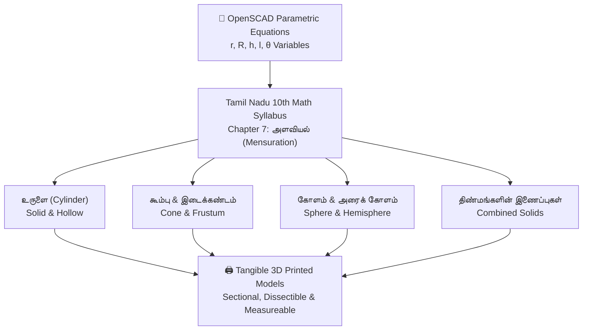

# Tamil Mensuration 3D Solids (அளவியல்) via OpenSCAD & 3D Printing

> **Tactile Geometric Learning for Tamil Nadu Samacheer Kalvi Mathematics (Class 10 - Chapter 7)**  
> *Developed by Dhamodharan KKP — Design Engineer & Makerspace Educator*

---

## 📐 Project Context & Pedagogical Need

In the Tamil Nadu State Board (Samacheer Kalvi) Class 10 Mathematics curriculum, **Chapter 7: Mensuration (அளவியல்)** introduces students to the calculation of **Curved Surface Area (வளைபரப்பு - CSA)**, **Total Surface Area (மொத்தப் புறப்பரப்பு - TSA)**, and **Volume (கனஅளவு)** of 3D geometric solids and their combinations.

For many rural students, two-dimensional textbook diagrams fail to build clear spatial intuition regarding:
* The difference between vertical height ($h$) and slant height ($l = \sqrt{h^2 + r^2}$) in a cone.
* How a frustum of a cone (இடைக்கண்டம்) is derived from cutting a larger cone.
* How compound solids (திண்மங்களின் இணைப்புகள்) combine volumes without double-counting interfacing surface areas.

This project delivers an **open-source parametric CAD system written in OpenSCAD** that allows students, teachers, and makerspaces to generate, dissect, and 3D print tangible geometric solids corresponding directly to textbook exercise problems.

---

## 🧱 Parametric 3D Solid Library



### 1. உருளை (Right Circular Cylinder) & உள்ளீடற்ற உருளை (Hollow Cylinder)
* **Parameters:** Internal radius ($r$), external radius ($R$), and height ($h$).
* **Tangible Feature:** Removable outer shells demonstrating why $\text{CSA} = 2\pi h(R + r)$ and internal volume calculation $\text{Volume} = \pi h(R^2 - r^2)$.

### 2. கூம்பு (Cone) & இடைக்கண்டம் (Frustum of a Cone)
* **Parameters:** Bottom radius ($R$), top radius ($r$), height ($h$), and slant height ($l$).
* **Tangible Feature:** Detachable top cone showing how an இடைக்கண்டம் (Frustum) is formed, allowing students to physically measure and verify $l = \sqrt{h^2 + (R - r)^2}$.

### 3. அரைக் கோளம் (Hemisphere) & கோளம் (Sphere)
* **Parameters:** Radius ($r$).
* **Tangible Feature:** Cross-sectional cutouts demonstrating the relationship between the flat circular base ($\pi r^2$) and the curved surface ($2\pi r^2$), proving visually why $\text{TSA} = 3\pi r^2$.

### 4. திண்மங்களின் இணைப்புகள் (Combination of Solids)
* **Textbook Classic Examples:**
  * Cylinder surmounted by a Cone (கூம்பு மற்றும் உருளை இணைந்த வடிவம் - e.g. circus tent).
  * Cylinder with hemispherical ends (இருபுறமும் அரைக் கோளம் இணைந்த உருளை - e.g. medicine capsule).
  * Cone mounted on a Hemisphere (அரைக் கோளத்தின் மீது கூம்பு - e.g. spinning top / toy).
* **Pedagogical Benefit:** Dissectible snap-together parts illustrate that while total volume is additive ($V_1 + V_2$), the interfacing base surfaces disappear from the total external surface area calculation.

---

## 💻 OpenSCAD Code Architecture

The script uses declarative, parameter-driven modules in OpenSCAD:

```openscad
// Tamil Mensuration: Cylinder Surmounted by Cone (கூம்பு + உருளை)
$fn = 100;

// Configurable Dimensions (mm)
cylinder_radius = 25; // உருளை ஆரம்
cylinder_height = 40; // உருளை உயரம்
cone_height = 30;     // கூம்பு உயரம்

module combined_toy() {
    // 1. Base Cylinder
    color("teal")
        cylinder(r = cylinder_radius, h = cylinder_height);
    
    // 2. Surmounted Cone
    color("coral")
        translate([0, 0, cylinder_height])
            cylinder(r1 = cylinder_radius, r2 = 0, h = cone_height);
}

combined_toy();
```

---

## 🏫 Classroom Implementation & Impact

* **Hands-on Measurement Labs:** Students use vernier calipers and rulers on 3D-printed solids to compute CSA, TSA, and volume empirically, comparing tactile measurements with analytical solutions.
* **Bilingual Terminology:** Physical parts feature embossed Tamil and English mathematical terms ($r$ - ஆரம், $h$ - உயரம், $l$ - சாயுயரம்).
* **Low-Cost Rural Deployment:** Fabricated at **Aarvam Learning Lab** and shared with government schools supported by **Payir** in rural Perambalur and Trichy.
